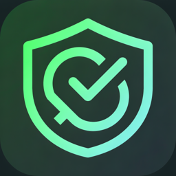
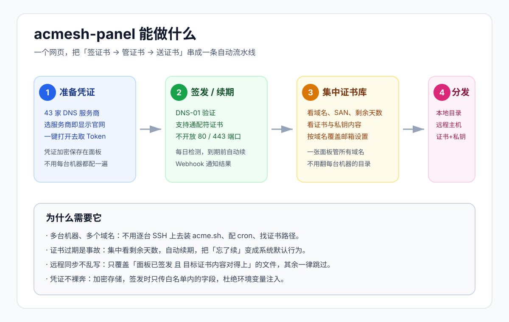
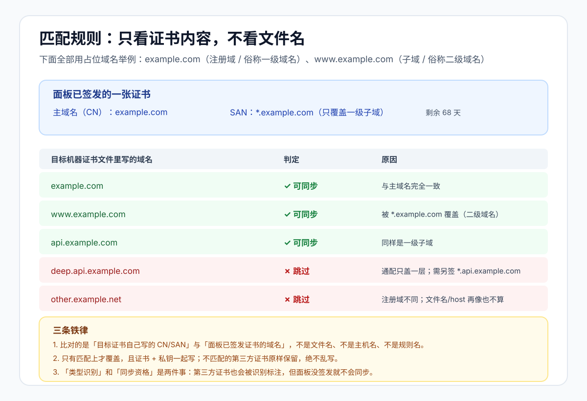
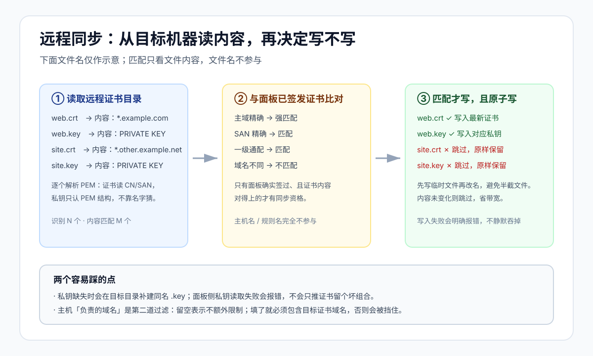

<div align="center">
  
</div>

# acmesh-panel (English Guide)

[](https://github.com/ForAllCodeSouls/acmesh-panel/actions/workflows/ci.yml)
[](https://github.com/ForAllCodeSouls/acmesh-panel/actions/workflows/docker.yml)
[](LICENSE)

> **简体中文完整文档：[README.md](README.md) · 日本語ガイド：[README.ja.md](README.ja.md)**
> This is a condensed English guide. The Chinese README is the authoritative, full documentation (per-OS steps, full FAQ).

**A lightweight certificate management panel for acme.sh, protected by a single username/password login.** One Go binary with an embedded web UI, shipped as a ~45 MB Alpine image. All state is stored in SQLite (transactional writes). Supports DNS API issuance (including wildcard certificates), per-domain ACME e-mail overrides, webhook notifications, and viewing / copying / downloading certificates and private keys from the web UI.

> **Lawful use**: only manage domains and servers you own or are explicitly authorized to manage. Illegal or unauthorized use is prohibited. Read the [Terms of Use & Disclaimer](DISCLAIMER.md) before use.

---

## Why use it



If you have one host and one domain, plain `acme.sh` is enough. This panel earns its place when you have several hosts and domains: issue once, then distribute certificates and keys automatically, see remaining validity at a glance, and never let a certificate expire unnoticed. DNS-01 validation means no public port 80/443 is required.

**How matching works** (all examples use placeholder domains): `example.com` is the registered domain; `www.example.com` is a subdomain. A certificate with `*.example.com` covers one level of subdomains only, so `www.example.com` matches but `deep.api.example.com` does not. Matching compares the CN/SAN **inside the target certificate file** with certificates already issued by the panel — never the filename or hostname. Unmatched third-party certificates are left untouched.





The full Chinese README has the detailed step-by-step explanation: [README.md](README.md).

---

## Features

| Area | Capability |
|---|---|
| **Authentication** | Single account + PBKDF2-HMAC-SHA256 (600k iterations); smart session cookie (plain `HttpOnly` over HTTP, `Secure` + `SameSite=Lax` when HTTPS is confirmed); CSRF token + smart same-origin check (hostname-based, reverse-proxy friendly, zero config); per-IP exponential lockout after 5 failures; optional 90-day "stay logged in"; env vars initialize credentials on first boot only — later changes made in the web UI persist across restarts, no web signup |
| **HTTPS only (optional)** | Settings → System can enforce HTTPS-only: direct HTTP access is silently dropped (no response, like an unused port) for pages and APIs alike (except `/api/health` for container health checks); the proxy must forward `X-Forwarded-Proto: https`. Emergency recovery: `ACME_PANEL_FORCE_HTTPS=0` + `docker compose up -d` |
| **Certificates** | Scans acme.sh home and parses X.509: SANs, issuer, validity, key type, days remaining, expiry alerts |
| **Issuance** | DNS API validation, wildcard support; 43 built-in DNS providers, each with verified credential fields and a direct official-site link (full list in [README.md §5.2](README.md#52-签发证书)); ECC 256/384 and RSA 2048/4096 |
| **E-mail** | Global default ACME e-mail + per-domain overrides |
| **Notifications** | Gotify / generic webhook / ServerChan³ / DingTalk / Feishu (Lark) / Bark; 11 subscribable events |
| **Private keys** | View + copy + download with double confirmation, audit logging, 60-second auto-clear |
| **Renewal** | Single / forced / all; built-in scheduler runs `acme.sh --cron` every 12 hours, no host cron needed |
| **Deployment** | `--install-cert` output to `/data/output/<cert>/` (fixed path) |
| **Local sync** | After issue/renew, matched certificate & key files are written into mounted sync dirs; 5 match modes (exact domain / subdomain / wildcard / filename / existing cert CN-SAN), atomic replace, content-fingerprint dedup, force overwrite |
| **Remote sync** | Push matched certs to other hosts over SSH/SFTP using the same rules; key or password auth, credentials encrypted at rest, strict host-key checking after first trust; per-host force/auto sync |
| **Sync records** | Local writes and remote syncs merged into one list; cert/key files from one batch are grouped, with keyword / result / scope / date filters and pagination |
| **Backup** | Export / import a single JSON config file (credentials stay encrypted; login credentials are never overwritten by a backup) |
| **Revoke / remove** | `--revoke`, `--remove` (optionally delete the on-disk directory) |
| **Audit log** | Logins, failures, CSRF blocks, issuance, renewal, key views, deployments, deletions, password change, backup export/import — all stored in SQLite and filterable in the web UI |
| **Frontend** | Hand-written HTML/CSS/JS embedded via `go:embed`, strict CSP, no frameworks, no CDN |
| **Sessions & IP allowlist** | List active sessions and revoke any (or all others); IPv4/IPv6 CIDR allowlist for the management entry with loopback bypass |
| **Operations** | One-click health check (acme.sh, dirs, CA, clock, DNS credentials); expiry board in four buckets; scheduled config backups with retention and readable summaries |
| **Reliability** | Exponential backoff auto-retry for failed jobs; config-change diff with secrets redacted and CSV export |
| **Lifecycle** | Batch issuance wizard; chain/private-key/OCSP verification; ACME account summary without exposing account keys |
| **Read-only tokens** | `X-API-Token` for GET endpoints with path scopes; hash-only storage, plaintext shown once; curl examples in the UI |
| **More** | Unified schedule page; Telegram and WeCom notification channels; zh/en/ja UI switch; CSV export for audit/jobs/sync/diffs |
| **Batch renewal (v0.1.71)** | Select several certificates on the expiry board and queue renewal at once; force mode adds `--force`; max 50 per batch; nonexistent names are skipped and reported |
| **Quiet hours (v0.1.71)** | Pause automatic notifications by weekday and time-of-day (including overnight windows); critical alerts can still pass; manual "send test" always works |
| **ACME accounts (v0.1.71)** | Switch the panel's default CA from the UI (locked when `ACME_PANEL_CA` is set); export an account key only after re-entering the login password, with path containment checks and an audit entry |

See [README.md §5.10–5.16](README.md) for details (Chinese; the tables above are the feature summary in each language). The complete HTTP API reference — authentication, read-only token scopes, all endpoints and curl examples — is in [docs/API.md](docs/API.md).

---

## Requirements

| Scenario | Requirement |
|---|---|
| Docker | Docker 20.10+ and Docker Compose v2 |
| Binary (Linux) | Any glibc/musl distro (static binary); install `acme.sh` + `curl` + `openssl` yourself |
| Binary (macOS) | macOS 11+, Intel or Apple Silicon; acme.sh installs natively |
| Binary (Windows) | Windows 10/11 x64; acme.sh needs WSL / Git Bash, or just use Docker |
| Port | Host `8800` → container `8080` |
| Network | Outbound access to the CA and DNS provider APIs during issuance |

---

## Quick start (Docker — recommended)

```bash
mkdir acmesh-panel && cd acmesh-panel
curl -fsSLO https://raw.githubusercontent.com/ForAllCodeSouls/acmesh-panel/main/docker-compose.yml
curl -fsSLO https://raw.githubusercontent.com/ForAllCodeSouls/acmesh-panel/main/.env.example
mv .env.example .env
```

Edit `.env` — `ACME_PANEL_PASSWORD` is **required** (compose refuses to start without it, 12+ chars):

```bash
openssl rand -base64 24        # generate, paste into ACME_PANEL_PASSWORD=
```

Then start:

```bash
docker compose pull && docker compose up -d
docker compose ps              # wait until healthy
```

Open `http://<host>:8800`, log in, then issue certificates from the **Certificates** tab (pick a DNS provider, paste its API credentials, enter domains, choose key type).

> Windows users: clone or download the repo, open PowerShell in the folder, and run the same commands. For Synology / Dockge / Portainer, copy the compose template from the Chinese README (§3.5).

---

## Quick start (binary)

```bash
# 1. install acme.sh (https://github.com/acmesh-official/acme.sh)
curl https://get.acme.sh | sh

# 2. install the panel binary (Linux amd64/arm64)
curl -fsSL https://raw.githubusercontent.com/ForAllCodeSouls/acmesh-panel/main/install.sh | sh

# 3. run with required env
ACME_PANEL_USER=admin \
ACME_PANEL_PASSWORD='a-long-random-password-12plus' \
ACME_PANEL_LISTEN=0.0.0.0:8800 \
acmesh-panel
```

A systemd unit example and macOS/Windows instructions are in the Chinese README (§4).

---

## Configuration reference

| Variable | Default | Description |
|---|---|---|
| `ACME_PANEL_PASSWORD` | random | 12+ chars; used **only on first boot** when the DB has no password; web changes persist and env no longer overwrites on restart. If unset and DB has no password, a random password is generated and printed to the log once |
| `ACME_PANEL_USER` | `admin` | Login name; first boot only |
| `ACME_PANEL_RESET_CREDENTIALS` | `0` | Set `1` together with both vars above to explicitly reset credentials once (forgot-password escape hatch) |
| `ACME_PANEL_LISTEN` | `0.0.0.0:8080` | Listen address **inside the container** |
| `ACME_PANEL_DATA` | `/data` | State, keys, audit, deploy output |
| `ACME_HOME` | `/acme.sh` | acme.sh home |
| `ACME_BIN` | auto | Path to the acme.sh script (binary deployments) |
| `ACME_PANEL_CA` | `letsencrypt` | `letsencrypt` / `zerossl` / `buypass` / `google` / `letsencrypt_test` |
| `ACME_PANEL_EMAIL` | empty | Passed as `--accountemail`; overrides the web-saved default |
| `ACME_PANEL_FORCE_HTTPS` | unset | **Optional**; overrides the HTTPS-only UI switch. `1` force on (HTTP silently dropped, like an unused port), `0` force off (emergency recovery); unset uses the saved UI setting. When set, the UI toggle is locked. Requires `docker compose up -d` after change; `restart` does not refresh env |
| `ACME_PANEL_TRUST_PROXY` | `0` | **Optional**; only chooses the IP used by rate limiting, never affects HTTP/HTTPS login. Trust `X-Forwarded-For` only behind a fully trusted reverse proxy |
| `ACME_PANEL_TRUST_PROXY_HOPS` | `1` | Number of trusted proxy hops (taken right-to-left from XFF) |
| `ACME_PANEL_ALLOW_LOCAL_WEBHOOK` | `0` | Local e2e testing only; allows webhooks to loopback/LAN (never in production) |
| `ACME_PANEL_CRON` | `1` | Daily renewal scheduler on/off |
| `ACME_PANEL_PARALLEL` | `2` | Task concurrency |
| `TZ` | `Asia/Shanghai` | Timezone for notifications and records |
| `ACME_PANEL_SYNC_DIR` | empty | Comma/semicolon-separated sync directories |

---

## Security model (summary)

- Passwords stored as PBKDF2-HMAC-SHA256 (600k iterations, random salt, constant-time compare).
- Sessions: in-memory + smart cookies — plain `HttpOnly` over plain HTTP, with `Secure` + `SameSite=Lax` added automatically when HTTPS is confirmed (`X-Forwarded-Proto: https` from the proxy or direct TLS). Works on both HTTP and HTTPS without switches; session ID rotates on login.
- The panel serves HTTP only. HTTPS is terminated by your nginx/Caddy; HSTS is emitted by the panel only when HTTPS is confirmed, never over plain HTTP (no more self-lockout).
- The optional HTTPS-only switch silently drops plain HTTP connections (pages and APIs return no response, like an unused port; `/api/health` is exempt); the proxy must forward `X-Forwarded-Proto: https`. If the proxy is misconfigured, set `ACME_PANEL_FORCE_HTTPS=0` and run `docker compose up -d` to recover — a container only reads env at creation time, so `restart` will not pick up the change.
- CSRF: token on every state-changing request; same-origin check compares hostnames (ignores port/scheme, honors `X-Forwarded-Host`), so a reverse proxy rewriting Host never locks you out, while cross-site requests are rejected when the public hostname is known.
- Static assets carry a version query string so upgrades bypass stale proxy caches without manual purging.
- Brute force: exponential per-IP/username lockout + security notifications.
- Credentials (DNS API keys, notify channels, SSH keys/passwords) encrypted with AES-256-GCM; API returns masked values; logs are scrubbed.
- Web UI: strict CSP, no inline scripts/styles, no CDN.
- Container: non-root uid 10001, `read_only` rootfs, `cap_drop ALL` (only `CHOWN` added).

- Read-only tokens: five scopes (`certs`/`jobs`/`sync`/`audit`/`overview`), path-prefix enforced. When the `X-API-Token` header is present, token permissions win even if a session cookie is also sent — a session cannot mask an unauthorized token. GET/HEAD only, SHA-256 storage, plaintext shown once.
- Quiet hours affect automatic notifications only; the manual "send test" always works. Security alerts, issuance failures and renewal failures pass through by default so a maintenance window never hides critical signals.
- Default CA can only be changed in the UI when `ACME_PANEL_CA` is unset (otherwise the API returns 409). The change applies to newly issued certificates only.
- Exporting an ACME account key requires re-entering the current password. The path is derived from the account ID and checked with `filepath.EvalSymlinks` + relative-path containment; symlinks outside `ACME_HOME` are rejected. Exports are audited and never cached.

Known boundaries: single account (no RBAC); private keys are viewable by the admin by design; acme.sh writes DNS credentials in plain text to `/acme.sh/account.conf`; the panel never terminates TLS itself. See [SECURITY.md](SECURITY.md).

---

## FAQ (highlights)

- **Forgot the password?** Set `ACME_PANEL_USER` + `ACME_PANEL_PASSWORD` + `ACME_PANEL_RESET_CREDENTIALS=1`, restart once, then remove the reset flag.
- **Login works but issuance fails?** Check DNS provider credentials and that the domain's NS points at the provider zone; the job log shows the acme.sh output verbatim.
- **Port already in use?** Change the left side of `8800:8080` in `docker-compose.yml`.
- **Behind a reverse proxy?** Terminate HTTPS on nginx/Caddy. Forward `X-Forwarded-Proto: https` so the panel adds `Secure`/HSTS; without it, login still works (plain cookie). No panel-side Cookie/HSTS switches; optionally set `ACME_PANEL_TRUST_PROXY=1` so rate limiting and the IP allowlist see the real client IP.
- **Using the IP allowlist behind a proxy?** Set `ACME_PANEL_TRUST_PROXY=1` first, or the panel sees the proxy's IP and may lock you out. Loopback is exempt by default; `/api/health` is always allowed. Invalid CIDR configuration conservatively rejects non-loopback clients.
- **Changed `.env` but nothing happened?** Run `docker compose up -d`. `restart` does not re-read container environment variables.
- **Notifications stopped?** Check Settings → Notifications → Quiet hours. A quiet window pauses automatic events; manual "send test" still works, so use it to confirm the channel itself.
- **"Default CA is locked" when switching?** `ACME_PANEL_CA` is set in the deployment. Change it there and recreate the container (`docker compose up -d`).
- **Need to automate monitoring?** Create a read-only token in Security Center and see [docs/API.md](docs/API.md) for endpoints and scope rules.

---

## Using the advanced pages

- **Security Center** — sessions (revoke any or all others), IPv4/IPv6 CIDR allowlist (loopback exempt, health endpoint always open), read-only API tokens with path scopes, and config-change diffs with secrets redacted. Token plaintext is shown once; only a SHA-256 hash is stored.
- **Operations Center** — one-click health check (acme.sh, directories, CA reachability, clock skew, decryptable DNS credentials), expiry board (expired / ≤7 days / ≤30 days / healthy), config backups with retention and readable summaries, and a schedule page with next-run times.
- **Lifecycle** — batch issuance wizard, chain/private-key/OCSP verification, ACME account summary and default-CA switching. Account keys are never shown on screen; export requires a password and is audited.
- **Expiry board batch renewal** — tick certificates, optionally enable force, and queue renewal. Each domain becomes its own job, so one failure never blocks the others.
- **CSV export** — audit, jobs, sync records and config diffs export as UTF-8-BOM CSV for direct Excel opening.

For per-field details see the Chinese README (§5.10–5.16) and the [API reference](docs/API.md).

---

## Build from source

Requires Go 1.26+ (pure Go, no CGO; dependencies: `modernc.org/sqlite`, `golang.org/x/crypto`, `github.com/pkg/sftp`).

```bash
go build -o acmesh-panel .
go vet ./... && go test ./...
```

---

## Terms of use & disclaimer

Only manage domains, servers, and certificates you own or are explicitly authorized to manage. Do not use this tool for unauthorized access, certificate replacement or hijacking, identity forgery, phishing, fraud, malware distribution, evasion of security controls, or any other activity violating applicable law, provider terms, or CA/Browser Forum Baseline Requirements. You are responsible for protecting credentials, restricting panel access, and reviewing audit logs.

The software is provided "as is", without warranties of any kind. The authors and maintainers are not liable for losses, penalties, claims, or legal liability arising from credential exposure, misconfiguration, operator error, third-party intrusion, or misuse. This is not legal advice. Full multilingual terms: [DISCLAIMER.md](DISCLAIMER.md); also available in the panel under Settings → Disclaimer.

---

## License

MIT — see [LICENSE](LICENSE). If this panel saved you a renewal headache, you can optionally buy the author a coffee (see the Chinese README).
