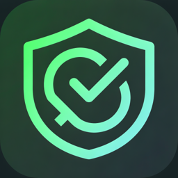
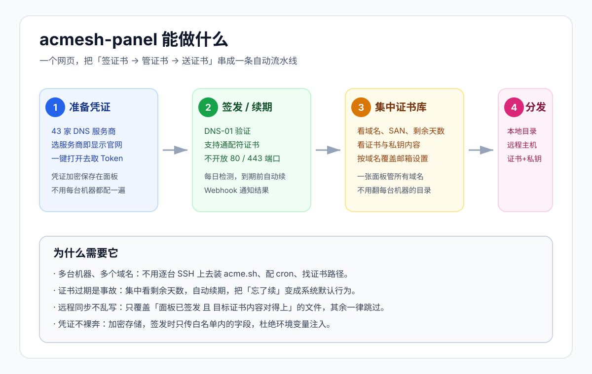
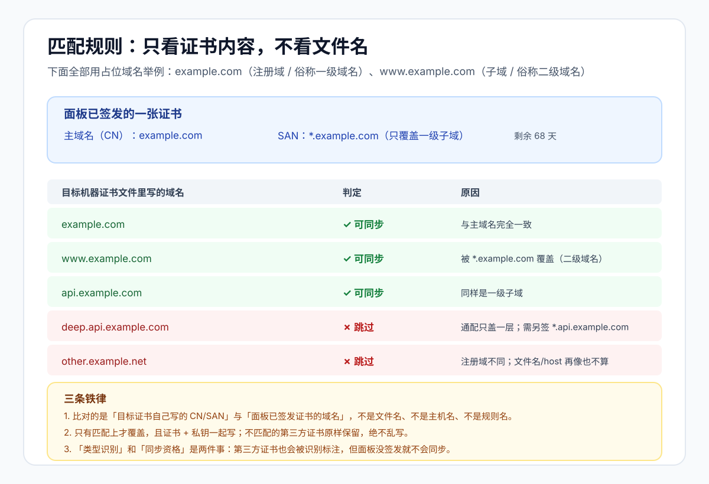
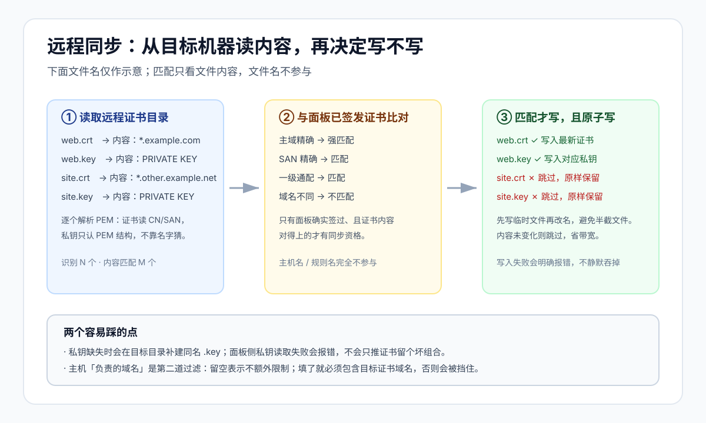

<div align="center">
  
</div>

# acmesh-panel（日本語ガイド）

[](https://github.com/ForAllCodeSouls/acmesh-panel/actions/workflows/ci.yml)
[](https://github.com/ForAllCodeSouls/acmesh-panel/actions/workflows/docker.yml)
[](LICENSE)

> **简体中文完全版ドキュメント：[README.md](README.md) · English guide：[README.en.md](README.en.md)**
> 本ドキュメントは要約版です。OS 別の詳細手順と FAQ 全文は中国語版（README.md）が正となります。

**アカウント / パスワードで保護された、軽量な acme.sh 証明書管理パネル。** Go 製シングルバイナリ + 組み込み Web UI、Alpine コンテナで動作しイメージは約 45 MB。状態はすべて SQLite に保存（トランザクション書き込みで半書きによる破損なし）。DNS API による自動発行（ワイルドカード対応）、ドメインごとの ACME メール上書き、Webhook 通知に対応し、証明書と秘密鍵を Web UI で表示・コピー・ダウンロードできます。

> **適法な利用について**：所有または明示的な許可を得たドメイン・サーバーのみを管理対象としてください。違法または無許可の利用は禁止されます。使用前必ず[利用規約と免責事項](DISCLAIMER.md)をお読みください。

---

## なぜ使うか



ホストとドメインが 1 つだけなら `acme.sh` 単体で十分です。複数ホスト・複数ドメインになると、このパネルの価値が出ます。発行は 1 か所で行い、証明書と秘密鍵を自動配布し、残日数を一覧で確認でき、更新忘れを仕組みで防げます。DNS-01 検証なので公開ポート 80/443 は不要です。

**一致ルール**（例はすべてプレースホルダ）: `example.com` が登録ドメイン、`www.example.com` がサブドメインです。`*.example.com` は 1 階層のサブドメインだけをカバーするため、`www.example.com` は一致しますが `deep.api.example.com` は一致しません。比較するのは**対象ファイル内の証明書の CN/SAN** とパネルが発行済みの証明書だけで、ファイル名やホスト名は一切使いません。一致しない第三者証明書は書き換えません。





詳しい手順は中国語の完全版ドキュメントを参照してください：[README.md](README.md)。

---

## 機能一覧

| 分類 | 機能 |
|---|---|
| **認証** | 単一アカウント + PBKDF2-HMAC-SHA256（600k 反復）；スマートセッション Cookie（HTTP では素の `HttpOnly`、HTTPS 確認時は `Secure` + `SameSite=Lax` を自動付与）；CSRF トークン + スマート同一オリジン検証（ホスト名比較、リバースプロキシ対応、設定不要）；IP ごとに 5 回失敗で指数バックオフロック；任意の 90 日「ログイン保持」。環境変数は**初回起動時のみ**認証情報を初期化し、以後は Web UI での変更が永続化。Web 登録画面なし |
| **HTTPS 限定（任意）** | 設定 → システムで有効化すると HTTP 直アクセス（ページ・API とも）をサイレント切断し、応答なし＝空ポートと同じ状態にします（コンテナのヘルスチェック用 `/api/health` は例外）。リバースプロキシは `X-Forwarded-Proto: https` を渡す必要あり。非常時は `ACME_PANEL_FORCE_HTTPS=0` + `docker compose up -d` で解除 |
| **証明書管理** | acme.sh home を走査して X.509 を解析：SAN・発行者・有効期限・鍵種別・残日数・期限切れ警告 |
| **発行** | DNS API 自動検証、ワイルドカード対応；43 種類の DNS プロバイダ内蔵（認証情報フィールドは acme.sh 公式スクリプトと照合済み、各プロバイダの公式サイトへのリンク付き、全一覧は [README.md §5.2](README.md#52-签发证书)）；ECC 256/384、RSA 2048/4096 |
| **メール** | グローバル既定 ACME メール + ドメイン別上書き |
| **通知** | Gotify / 汎用 Webhook / ServerChan³ / DingTalk / Feishu(Lark) / Bark、11 種類のイベント購読 |
| **秘密鍵** | 二重確認 + 監査ログ + 60 秒自動クリア、コピー・ダウンロード対応 |
| **更新** | 個別 / 強制 / 全件；内蔵スケジューラが 12 時間ごとに `acme.sh --cron` を実行（ホスト cron 不要） |
| **デプロイ** | `--install-cert` 出力先は `/data/output/<証明書>/`（固定パス） |
| **ローカル同期** | 発行 / 更新後、ルールに一致した証明書・鍵ファイルをマウント済み同期ディレクトリへ書き込み；5 種類の一致モード（完全一致 / サブドメイン / ワイルドカード / ファイル名 / 既存証明書 CN-SAN）、アトミック置換、内容フィンガープリント重複排除、強制上書き |
| **リモート同期** | 同じルールで一致した証明書を SSH/SFTP で他ホストへ送信；鍵 or パスワード認証、認証情報は暗号化保存、初回信頼後はホスト鍵を厳格検証；ホストごとの強制 / 自動同期 |
| **同期記録** | ローカル書き込みとリモート同期を 1 つのリストに統合表示、同一バッチの証明書/秘密鍵をまとめて表示、キーワード / 結果 / 範囲 / 日付フィルタとページング対応 |
| **バックアップ** | JSON 1 ファイルでのエクスポート / インポート（認証情報は暗号文のまま、ログイン認証情報はバックアップで上書きされない） |
| **失効 / 削除** | `--revoke`、`--remove`（ディスク上のディレクトリ削除も任意） |
| **監査ログ** | ログイン・失敗・CSRF ブロック・発行・更新・鍵閲覧・デプロイ・削除・パスワード変更・バックアップ入出力をすべて SQLite に記録、Web UI でフィルタ可能 |
| **フロントエンド** | 手書き HTML/CSS/JS を `go:embed` で内蔵、厳格 CSP、フレームワーク・CDN 不使用 |
| **セッションと IP 許可リスト** | アクティブセッション一覧と個別 / 他すべて強制ログアウト；管理入口の IPv4/IPv6 CIDR 許可リスト（ループバック除外可） |
| **運用** | ワンクリックヘルスチェック（acme.sh / ディレクトリ / CA / 時刻 / DNS 認証情報）；期限切れダッシュボード；保持数付き自動バックアップと要約閲覧 |
| **信頼性** | 失敗ジョブの指数バックオフ自動再試行；機微情報をマスキングした設定変更差分と CSV エクスポート |
| **ライフサイクル** | 一括発行ウィザード；チェーン / 秘密鍵 / OCSP 検証；アカウント鍵を晒さない ACME アカウント摘要 |
| **読み取り専用トークン** | `X-API-Token` で GET エンドポイントへアクセス、パススコープ指定可；ハッシュのみ保存、平文は作成時のみ表示 |
| **その他** | 統合スケジュール画面；Telegram と企業 WeChat 通知；zh/en/ja UI 切替；監査 / ジョブ / 同期 / 差分の CSV 出力 |

詳細は [README.md §5.10～5.15](README.md) を参照（中国語）。

---

> 注：上の表は各言語の機能概要です。詳細な手順は中国語 README に統一されています。

---

## 要件

| シナリオ | 要件 |
|---|---|
| Docker | Docker 20.10+ と Docker Compose v2 |
| バイナリ（Linux） | glibc/musl の任意ディストロ（静的リンク）；`acme.sh` + `curl` + `openssl` は別途インストール |
| バイナリ（macOS） | macOS 11+、Intel または Apple Silicon；acme.sh は macOS に直接インストール可能 |
| バイナリ（Windows） | Windows 10/11 x64；acme.sh は WSL / Git Bash が必要、または Docker を利用 |
| ポート | ホスト `8800` → コンテナ `8080` |
| 通信 | 発行時に CA と DNS プロバイダ API への外向き接続が必要 |

---

## クイックスタート（Docker・推奨）

```bash
mkdir acmesh-panel && cd acmesh-panel
curl -fsSLO https://raw.githubusercontent.com/ForAllCodeSouls/acmesh-panel/main/docker-compose.yml
curl -fsSLO https://raw.githubusercontent.com/ForAllCodeSouls/acmesh-panel/main/.env.example
mv .env.example .env
```

`.env` を編集 — `ACME_PANEL_PASSWORD` は**必須**（未設定のままでは compose が起動しません、12 文字以上）：

```bash
openssl rand -base64 24        # 生成して ACME_PANEL_PASSWORD= に貼り付け
```

起動：

```bash
docker compose pull && docker compose up -d
docker compose ps              # healthy になるまで待つ
```

`http://<ホスト>:8800` を開いてログインし、**証明書**タブから発行（DNS プロバイダを選択 → API 認証情報を貼り付け → ドメイン入力 → 鍵種別を選択）。

> Synology / Dockge / Portainer 向け compose テンプレートは中国語版 README の §3.5 を参照。

---

## クイックスタート（バイナリ）

```bash
# 1. acme.sh をインストール（https://github.com/acmesh-official/acme.sh）
curl https://get.acme.sh | sh

# 2. パネル本体をインストール（Linux amd64/arm64）
curl -fsSL https://raw.githubusercontent.com/ForAllCodeSouls/acmesh-panel/main/install.sh | sh

# 3. 必須 env を付けて起動
ACME_PANEL_USER=admin \
ACME_PANEL_PASSWORD='12文字以上の長いランダムパスワード' \
ACME_PANEL_LISTEN=0.0.0.0:8800 \
acmesh-panel
```

systemd ユニット例および macOS / Windows の手順は中国語版 README の §4 を参照。

---

## 設定リファレンス

| 変数 | 既定 | 説明 |
|---|---|---|
| `ACME_PANEL_PASSWORD` | ランダム生成 | 12 文字以上；DB にパスワードがない**初回起動時のみ**使用。Web での変更は永続化され、再起動時に env で上書きされない。未設定かつ DB にも無い場合、起動時にランダム生成してログへ一度だけ表示 |
| `ACME_PANEL_USER` | `admin` | ログイン名；初回起動のみ |
| `ACME_PANEL_RESET_CREDENTIALS` | `0` | 上記 2 変数と併せて `1` にすると起動時に一度だけ明示リセット（パスワード忘れ時の逃げ道） |
| `ACME_PANEL_LISTEN` | `0.0.0.0:8080` | **コンテナ内**リッスンアドレス |
| `ACME_PANEL_DATA` | `/data` | 状態・鍵・監査・デプロイ出力 |
| `ACME_HOME` | `/acme.sh` | acme.sh home |
| `ACME_BIN` | 自動 | バイナリデプロイ時の acme.sh スクリプトパス |
| `ACME_PANEL_CA` | `letsencrypt` | `letsencrypt` / `zerossl` / `buypass` / `google` / `letsencrypt_test` |
| `ACME_PANEL_EMAIL` | 空 | `--accountemail` として渡す；Web 保存の既定メールより優先 |
| `ACME_PANEL_FORCE_HTTPS` | 未設定 | **任意**。HTTPS 限定スイッチを上書き。`1` 強制オン（HTTP をサイレント切断・空ポート相当）、`0` 強制オフ（非常時復旧）。未設定なら Web の設定値を使用。設定時は UI から変更不可。変更後は `docker compose up -d` が必要（`restart` では env が更新されない） |
| `ACME_PANEL_TRUST_PROXY` | `0` | **任意**。レート制限の IP 判定にのみ影響し、HTTP/HTTPS ログインには無関係。完全に信頼できるリバースプロキシのみで `X-Forwarded-For` を信頼 |
| `ACME_PANEL_TRUST_PROXY_HOPS` | `1` | 信頼するプロキシの段数（XFF の右から N 番目） |
| `ACME_PANEL_ALLOW_LOCAL_WEBHOOK` | `0` | ローカル e2e テスト専用；ループバック / LAN 向け Webhook を許可（本番では禁止） |
| `ACME_PANEL_CRON` | `1` | 日次更新スケジューラの ON/OFF |
| `ACME_PANEL_PARALLEL` | `2` | タスク並列数 |
| `TZ` | `Asia/Shanghai` | 通知・記録のタイムゾーン |
| `ACME_PANEL_SYNC_DIR` | 空 | 同期ディレクトリ（カンマ / セミコロン区切り） |

---

## セキュリティモデル（要約）

- パスワードは PBKDF2-HMAC-SHA256（600k 反復、ランダムソルト、定数時間比較）で保存。
- セッション：インメモリ + スマート Cookie。平文 HTTP では素の `HttpOnly` Cookie、HTTPS 確認時（`X-Forwarded-Proto: https` または直接 TLS）は自動で `Secure` + `SameSite=Lax` を付与。設定なしで HTTP / HTTPS 両方で動作、ログイン時にセッション ID を再生成。
- パネルは HTTP のみ提供。HTTPS は nginx/Caddy で終端。HSTS は HTTPS 確認時のみパネルが送信し、平文 HTTP では送信しないため自分をロック out しません。
- 任意の HTTPS 限定スイッチは平文 HTTP をサイレント切断します（ページ・API とも応答なし＝空ポート相当、`/api/health` は例外）。プロキシは `X-Forwarded-Proto: https` を渡す必要があります。設定ミス時は `ACME_PANEL_FORCE_HTTPS=0` にして `docker compose up -d` で復旧できます（コンテナは作成時にのみ env を読み込むため `restart` では変更が反映されません）。
- CSRF：状態変更リクエストすべてにトークンを検証。同一オリジン検証はホスト名で比較（ポート/スキーム無視、`X-Forwarded-Host` 対応）するため、リバースプロキシが Host を書き換えてもログインでき、公開ホスト名が分かる場合はクロスサイトを拒否します。
- 静的アセットは URL にバージョンを付与し、アップグレード時に古いプロキシキャッシュを自動で回避します。
- 総当たり：IP + ユーザー名ごとの指数バックオフロック + セキュリティ通知。
- 認証情報（DNS API キー・通知チャネル・SSH 鍵/パスワード）は AES-256-GCM で暗号化保存；API はマスク値のみ返却；ログは値をマスキング。
- Web UI：厳格 CSP、インラインスクリプト / スタイルなし、CDN 不使用。
- コンテナ：非 root uid 10001、`read_only` ルートfs、`cap_drop ALL`（`CHOWN` のみ追加）。

既知の限界：単一アカウント（RBAC なし）；秘密鍵は設計上管理者が閲覧可能；acme.sh は DNS 認証情報を `/acme.sh/account.conf` に平文で書き込む；パネルは TLS を終端しません。詳細は [SECURITY.md](SECURITY.md)。

---

## FAQ（抜粋）

- **パスワードを忘れた**：`ACME_PANEL_USER` + `ACME_PANEL_PASSWORD` + `ACME_PANEL_RESET_CREDENTIALS=1` を設定して一度再起動し、完了後は必ず解除。
- **ログインできるが発行に失敗する**：DNS プロバイダの認証情報とドメイン NS の向きを確認；ジョブログに acme.sh の出力がそのまま表示されます。
- **ポート競合**：`docker-compose.yml` の `8800:8080` の左側を変更。
- **リバースプロキシ背後**：nginx/Caddy 側で HTTPS を終端。`X-Forwarded-Proto: https` を渡せばパネルが `Secure` / HSTS を付与。渡さなくてもログインは可能。パネル側の Cookie / HSTS スイッチは不要。レート制限を実クライアント IP で取りたい場合のみ `ACME_PANEL_TRUST_PROXY=1` を設定。

---

## ソースからビルド

Go 1.26+（純 Go、CGO 不要；依存：`modernc.org/sqlite`、`golang.org/x/crypto`、`github.com/pkg/sftp`）。

```bash
go build -o acmesh-panel .
go vet ./... && go test ./...
```

---

## 利用規約と免責事項

所有またはドメイン所有者 / サーバー所有者から明示的に許可されたドメイン、サーバー、証明書のみを管理対象としてください。無許可のアクセス、証明書の差し替え・ハイジャック、なりすまし、フィッシング、詐欺、マルウェア配布、セキュリティ制御の回避、および適用法・プロバイダ規約・CA/Browser Forum ベースライン要件に違反する行為に使用してはなりません。認証情報の保護、パネルのアクセス制限、監査ログの確認は利用者の責任です。

本ソフトウェアは「現状のまま」提供され、保証は一切ありません。認証情報の漏えい、設定ミス、誤操作、第三者による侵入、悪用による損害・処分・請求・法的責任について、作者およびメンテナーは責任を負いません。本説明は法的助言ではありません。完全な多言語条項は [DISCLAIMER.md](DISCLAIMER.md)、パネル内の「設定 → 免責声明」でも確認できます。

---

## ライセンス

MIT — [LICENSE](LICENSE) を参照。このパネルが更新の手間を省いてくれたら、中国語版 README から任意でコーヒーを一杯おごっていただけます ☕。
