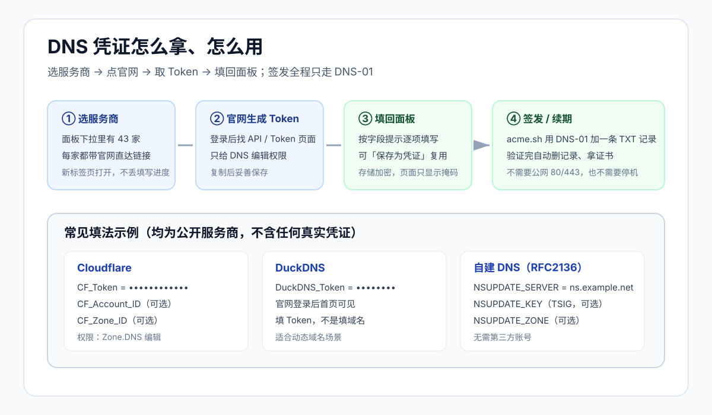
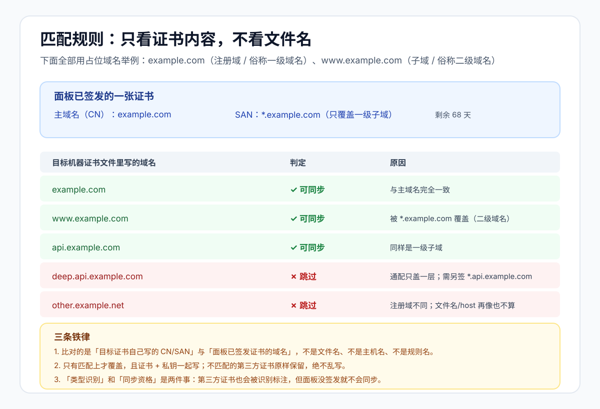

<div align="center">
  
</div>

# acmesh-panel

[](https://github.com/ForAllCodeSouls/acmesh-panel/actions/workflows/ci.yml)
[](https://github.com/ForAllCodeSouls/acmesh-panel/actions/workflows/docker.yml)
[](LICENSE)

**一个带账号密码登录的轻量 acme.sh 证书管理面板。** Go 单二进制 + 内嵌前端，跑在 Alpine 容器里，镜像约 45 MB；数据统一存 SQLite（事务写入，不会因半写丢数据）；内置 43 家 DNS 服务商凭证（每家带官网直达链接），支持 DNS API 自动签发（含泛域名）、按域名自定义 ACME 邮箱、Webhook 通知；证书与私钥可在 Web 里查看、复制、下载，并可按「证书内容匹配」同步到本地挂载目录或远程主机。

---

## 🌍 文档语言 / Documentation Languages / ドキュメント言語

| 语言 | 文档 | 说明 |
|---|---|---|
| 简体中文 | [README.md](README.md) | 完整文档（部署 / 使用 / 配置参考 / FAQ） |
| English | [README.en.md](README.en.md) | English guide (condensed: quick start, features, config reference) |
| 日本語 | [README.ja.md](README.ja.md) | 日本語ガイド（要約版：クイックスタート、機能、設定一覧） |

English / 日本語 版为精简指南，覆盖部署与日常使用所需的全部内容；完整细节（逐平台步骤、FAQ 全文）以中文版为准。

---

## ☕ 支持本项目

如果这个面板帮你省过一次续期的麻烦，欢迎自愿赞赏一杯咖啡 ☕。
赞赏**完全自愿**：不影响任何功能、不换取任何服务承诺、不是付费墙。

| 微信支付 | 支付宝 |
| :------: | :----: |
|  |  |

---

## 文档导航

文档按「怎么装」和「怎么用」分开，先选部署方式，再看使用说明。

| 你想做什么 | 去哪里 |
|---|---|
| 用 Docker 装（含群晖 / Dockge / Portainer） | [第一部分：Docker 部署](#第一部分docker-部署) → 按 [Linux](#32-linux-使用方法) / [macOS](#33-macos-使用方法) / [Windows](#34-windows-使用方法) 看 |
| 不用 Docker，直接跑二进制 | [第二部分：二进制部署](#第二部分二进制部署) → 按 [Linux](#42-linux-使用方法) / [macOS](#43-macos-使用方法) / [Windows](#44-windows-使用方法) 看 |
| 装好了，想知道面板怎么用 | [第三部分：使用说明](#第三部分使用说明)（签发、通知、同步、续期等） |
| 第一次看，想知道这项目解决什么问题 | [为什么用这个项目](#为什么用这个项目) |
| 查配置项 / 排查报错 | [配置参考](#7-配置参考) · [常见问题](#10-常见问题) |

---

## 为什么用这个项目


如果你只有一台机器、一个域名，手敲 acme.sh 就够了。当你开始遇到下面这些情况，面板的价值就出来了：

- **多台机器、多个域名**：签发在一台机器，Nginx / 网关 / 路由器在别的机器。不用逐台 SSH 上去装 acme.sh、配 cron、记证书路径。
- **证书过期是事故**：面板集中显示每张证书的剩余天数，自动续期，把「忘了续」变成系统默认行为。
- **DNS 凭证难管**：43 家服务商的凭证加密存一处，选服务商时直接显示官网链接，点开就能去取 Token；凭证只以掩码显示。
- **同步最怕写坏文件**：本地目录和远程主机都按「证书实际签发的域名」匹配；主机名、文件名、规则名都不参与匹配，不匹配的第三方证书原样保留。
- **不出网也能签发**：DNS-01 验证不需要开放 80 / 443，也不需要把 Web 服务暴露到公网。

它能实现什么，一句话：**在网页上完成签发、续期、查看、通知、分发这一整条证书生命周期，并且保证分发只写到该写的文件里。**

下面几张图会把「凭证怎么拿」「域名怎么匹配」「远程怎么同步」讲清楚，全部用 `example.com` / `example.net` 占位域名举例，不涉及任何真实站点。

---

## 1. 功能一览

| 分类 | 能力 |
|---|---|
| **登录认证** | 单账号 + PBKDF2-HMAC-SHA256（600k 次迭代）；Cookie `HttpOnly` + `SameSite=Strict`；CSRF Token + Origin 校验；5 次失败按 IP 指数退避锁定；可选「保持登录」90 天；环境变量仅首次初始化账号密码，之后可在设置页修改并持久保存，无 Web 注册入口 |
| **证书管理** | 扫描 acme.sh home，解析 x509：SAN、签发者、有效期、密钥类型、剩余天数、过期告警 |
| **签发** | DNS API 自动验证，支持泛域名；内置 43 家 DNS 服务商（见 [5.2 服务商清单](#52-签发证书)），每家都带官网直达链接，字段与 acme.sh 官方脚本逐一核对；ECC 256/384、RSA 2048/4096 |
| **邮箱** | 全局默认 ACME 邮箱 + 按域名覆盖，留空自动回落 |
| **通知** | Gotify / 通用 Webhook / Server 酱³ / 钉钉 / 飞书 / Bark，11 种事件可订阅 |
| **私钥** | 明文查看 + 一键复制 + 下载，二次确认 + 审计 + 60 秒自动清屏 |
| **续期** | 单个 / 强制 / 全部；内置调度每天定时 `acme.sh --cron`，不依赖容器内 cron |
| **部署** | `--install-cert` 输出到 `/data/output/<证书>/`，路径固定 |
| **证书同步** | 挂载目录自动覆盖：签发/续期后把新证书与私钥写入匹配文件；5 种匹配模式（精确域名 / 子域 / 通配 / 文件名 / 现有证书 CN-SAN），**严格按证书实际签发的域名匹配**（只认 CN/SAN 与通配符覆盖的一级子域，证书没签的域名不认），**精确归属优先**（文件名域名已有同名独立证书时泛域/子域匹配不抢写），原子替换、证书内容指纹去重、强制同步可重写；自动推送按规则选中的主机（规则可选）；手动远程同步按目标机器上证书内容对比，命中文件直接写入最新证书/私钥 |
| **远程主机同步** | 通过 SSH/SFTP 把最新证书/私钥写到目标主机对应文件；手动同步只按目标机证书内容（CN/SAN）与面板已签发证书对比，规则、文件名、主机名称都不参与匹配；支持私钥或账号密码认证，凭证加密落盘、不进命令行，主机密钥首次信任后严格校验；可强制同步或按主机开启自动同步 |
| **同步记录** | 本地写入与远程同步结果合并展示，支持关键词 / 结果 / 范围 / 日期筛选与分页 |
| **备份恢复** | 「设置 → 备份恢复」导出 / 导入单个 JSON 配置文件；凭证以密文保存，登录凭据不随备份覆盖 |
| **吊销 / 移除** | `--revoke`、`--remove`（可选连带删除磁盘目录） |
| **审计** | 登录、失败、CSRF 拦截、签发、续期、私钥查看、部署、删除、改密、备份导出 / 恢复全量落 SQLite，Web 可查，可配置保留天数 |
| **前端** | 手写 HTML/CSS/JS，`go:embed` 进二进制，严格 CSP，无框架无 CDN |

## 2. 环境要求

| 场景 | 要求 |
|---|---|
| Docker 部署 | Docker 20.10+ 与 Docker Compose v2（`docker compose` 子命令） |
| 二进制部署（Linux） | 任意 glibc/musl 发行版，静态链接无系统依赖；另需自行安装 `acme.sh` + `curl` + `openssl` |
| 二进制部署（macOS） | macOS 11+，Intel（amd64）或 Apple Silicon（arm64）；acme.sh 可直接安装在 macOS 上 |
| 二进制部署（Windows） | Windows 10/11 x64；acme.sh 需 WSL / Git Bash，或直接用 Docker |
| 源码构建 / 测试 | Go 1.26+、Python 3.12+、Node 20+（Node 仅用于前端静态检查）；依赖 `modernc.org/sqlite`、`golang.org/x/crypto`、`github.com/pkg/sftp`，均为纯 Go、无 CGO |
| 端口 | **宿主机 8800** → 容器 8080（容器内不需要改） |
| 出网 | 签发时需要访问 CA 与 DNS 服务商 API；不能出网请配代理 |

---

# 第一部分：Docker 部署

镜像已内置 acme.sh、curl、openssl、bash，只需一个 compose 文件和一个密码。

## 3. Docker 部署

### 3.1 开始前准备（三个系统通用）

**方式 A：用 Dockge / Portainer（推荐新手）——不用下载文件**

直接看 [3.5 完整配置模板](#35-完整配置模板dockge--portainer-复制即用)，把 Compose 整段粘到面板里即可（密码写在 YAML 里，不需要 .env），跳过 `.env` 相关步骤。

**方式 B：命令行——先下载项目**

```bash
git clone https://github.com/ForAllCodeSouls/acmesh-panel.git
cd acmesh-panel
ls docker-compose.yml .env.example
```

Windows 用户：打开仓库页面 → 绿色 **Code** → **Download ZIP** → 解压 → 在解压目录里打开 PowerShell（地址栏输入 `powershell` 回车）。

**准备 `.env`**（`ACME_PANEL_PASSWORD` 必填，不填 compose 会直接报错退出）：

```bash
cp .env.example .env
openssl rand -base64 24        # 复制输出，填到 .env 的 ACME_PANEL_PASSWORD= 后面
```

`.env` 完整内容（密码换成你自己的，其余可不动）：

```ini
ACMESH_IMAGE_TAG=latest
ACME_PANEL_USER=admin
ACME_PANEL_PASSWORD=HF4ARz1IIZarLtvv
ACME_PANEL_COOKIE_SECURE=0
ACME_PANEL_TRUST_PROXY=0
ACME_PANEL_CRON=1
ACME_PANEL_CA=letsencrypt
ACME_PANEL_EMAIL=you@example.com
TZ=Asia/Shanghai
# 证书同步（可选）：需要时取消注释并对应挂载卷
# ACME_PANEL_SYNC_DIR=/certs
```

### 3.2 Linux 使用方法

在**项目目录**（能看到 `docker-compose.yml` 的地方）执行：

```bash
cd <项目目录>
cp .env.example .env
# 生成并写入强密码（Linux 的 sed 可直接 -i）
sed -i "s|^ACME_PANEL_PASSWORD=.*|ACME_PANEL_PASSWORD=$(openssl rand -base64 24 | tr -dc 'A-Za-z0-9' | head -c 24)|" .env
docker compose pull
docker compose up -d
docker compose ps          # 状态显示 healthy 即成功
```

浏览器打开 `http://服务器IP:8800`，账号 `admin`，密码是 `.env` 里设置的那个。如服务器有防火墙 / 安全组，需放行 8800。

**从源码本地构建**（没有 GHCR 镜像或想改代码时用）：

```bash
docker compose -f docker-compose.yml -f docker-compose.build.yml up -d --build
```

`docker-compose.build.yml` 是 override，用当前目录的 Dockerfile 构建，镜像名 `acmesh-panel:local`；不加它时只使用 GHCR 镜像。

### 3.3 macOS 使用方法

1. 安装 [Docker Desktop for Mac](https://www.docker.com/products/docker-desktop/)，启动后确认终端里 `docker compose version` 有输出。
2. 如果要用「证书同步」挂载宿主机目录，先在 Docker Desktop → **Settings → Resources → File Sharing** 里把该目录加进共享列表，否则容器内看不到。
3. 在项目目录执行（用 `perl` 改密码，Linux/macOS 通用；macOS 自带 BSD `sed` 的 `-i` 语法与 Linux 不同）：

```bash
cd <项目目录>
cp .env.example .env
PANEL_PWD=$(openssl rand -base64 24 | tr -dc 'A-Za-z0-9' | head -c 24)
perl -pi -e "s|^ACME_PANEL_PASSWORD=.*|ACME_PANEL_PASSWORD=$PANEL_PWD|" .env
echo "登录密码: $PANEL_PWD"
docker compose pull
docker compose up -d
docker compose ps
```

4. 浏览器打开 `http://localhost:8800`。Apple Silicon（M 系列）拉取的是 `linux/arm64` 镜像，无需额外设置。

> 不使用 Docker、想直接跑原生二进制请看 [4.3 macOS 使用方法](#43-macos-使用方法)。

### 3.4 Windows 使用方法

1. 安装 [Docker Desktop for Windows](https://www.docker.com/products/docker-desktop/)，首次启动按提示启用 WSL 2 后端。
2. 在 PowerShell 里进入项目目录（地址栏输入 `powershell` 回车），整段粘贴：

```powershell
cd <项目目录>
Copy-Item .env.example .env -Force
$panelPwd = 'Acme_' + [guid]::NewGuid().ToString('N').Substring(0,20)
(Get-Content .env -Raw) -replace 'ACME_PANEL_PASSWORD=.*', "ACME_PANEL_PASSWORD=$panelPwd" | Set-Content .env -Encoding ascii -NoNewline
Write-Host "登录密码: $panelPwd" -ForegroundColor Green
docker compose pull
docker compose up -d
docker compose ps
```

3. 浏览器打开 `http://localhost:8800`。

> **注意**：Windows 下 compose 文件里的卷路径请用 Docker Desktop 能识别的路径（如 `/c/Users/...`）或直接使用命名卷；不要写 `C:\...` 反斜杠路径。只想用面板的话，Docker 方式比原生二进制省事（acme.sh 不用另装）。

### 3.5 完整配置模板（Dockge / Portainer 复制即用）

**Compose（整段粘贴）**——密码直接写在 YAML 里，不依赖 `.env`，复制后把 `改成至少12位的强密码` 换掉即可：

```yaml
services:
  acmesh-panel:
    image: ghcr.io/forallcodesouls/acmesh-panel:latest
    container_name: acmesh-panel
    restart: unless-stopped
    ports:
      - "0.0.0.0:8800:8080"
    environment:
      ACME_PANEL_USER: "admin"
      ACME_PANEL_PASSWORD: "HF4ARz1IIZarLtvv"
      ACME_PANEL_COOKIE_SECURE: "0"
      ACME_PANEL_TRUST_PROXY: "0"
      ACME_PANEL_CRON: "1"
      ACME_PANEL_CA: "letsencrypt"
      ACME_PANEL_EMAIL: "you@example.com"
      TZ: "Asia/Shanghai"
      # 证书同步（可选）：需要时填容器内目录，并在下方 volumes 挂载同名路径
      # ACME_PANEL_SYNC_DIR: "/certs"
    volumes:
      - acme_home:/acme.sh
      - panel_data:/data
      # 证书同步（可选）：取消注释并把宿主机路径换成你的目录
      # - /home/web/certs:/certs
    read_only: true
    tmpfs:
      - /tmp:size=16m,mode=1777
    cap_drop:
      - ALL
    # 用于 docker exec -u root chown 修复挂载目录权限；面板进程仍非 root
    cap_add:
      - CHOWN
    security_opt:
      - no-new-privileges:true
    healthcheck:
      test: ["CMD", "wget", "-q", "-O-", "http://127.0.0.1:8080/api/health"]
      interval: 30s
      timeout: 3s
      retries: 3
      start_period: 5s

volumes:
  acme_home:
  panel_data:
```

> 面板里**不要再单独粘贴 .env**：上面的变量已写死在 YAML 里。想用 `.env` 变量方式请参考 3.1 / 3.2 的命令行部署。

**各面板怎么填**：

| 面板 | 操作 |
|---|---|
| Dockge | 新建 Stack → 名称 `acmesh-panel` → Compose 框粘贴上面 YAML → 点「Deploy」 |
| Portainer | Stacks → Add stack → Name 填 `acmesh-panel` → Build method 选 Web editor → 粘贴 YAML → Deploy |
| 宝塔 / 1Panel | 容器/Compose → 新建模板 → 粘贴 YAML → 保存并启动 |

> **端口说明**：`0.0.0.0:8800:8080` 表示监听所有网卡的 8800 → 容器 8080。只想改对外端口，改冒号左边的数字即可。

### 3.6 日常运维命令

| 命令 | 作用 |
|---|---|
| `docker compose ps` | 查看容器状态与 health |
| `docker compose logs -f acmesh-panel` | 实时日志（按 `.env` 同步账号密码；未设密码时打印随机初始密码） |
| `docker compose restart` | 重启容器（不重建，不会重读 .env） |
| `docker compose up -d` | 应用 `.env` / compose 变更并重建 |
| `docker compose down` | 停止并删除容器，**数据卷保留** |
| `docker compose down -v` | ⚠️ 连证书和面板数据一起删除，不可恢复 |
| `docker compose exec acmesh-panel /acme.sh/acme.sh --version` | 在容器里调用 acme.sh |
| `docker compose pull && docker compose up -d` | 升级镜像 |

### 3.7 远程访问

默认监听所有网卡的 `0.0.0.0:8800`，浏览器直接打开 `http://服务器IP:8800`。如服务器有防火墙/安全组，需放行 8800 端口。

需要域名 + HTTPS 时，可用 Caddy 或 Nginx 反代：

**Caddy**

```
certs.example.com {
    reverse_proxy 127.0.0.1:8800
}
```

**Nginx**

```nginx
server {
    listen 443 ssl http2;
    server_name certs.example.com;
    ssl_certificate     /etc/nginx/certs/fullchain.pem;
    ssl_certificate_key /etc/nginx/certs/key.pem;

    location / {
        proxy_pass http://127.0.0.1:8800;
        proxy_set_header Host $host;
        proxy_set_header X-Forwarded-For $remote_addr;   # 同时设 ACME_PANEL_TRUST_PROXY=1
        proxy_buffering off;                              # SSE 实时日志需要
        proxy_read_timeout 3600s;
    }
}
```

也可以让面板自己终结 TLS：挂载证书并设置 `ACME_PANEL_TLS_CERT` / `ACME_PANEL_TLS_KEY`，端口照样映射 8800。

### 3.8 数据卷与备份

| 卷 | 挂载点 | 内容 |
|---|---|---|
| `panel_data` | `/data` | 统一数据库 `panel.db`（配置、加密凭证、任务、审计、同步记录）、主密钥 `secret.key`、部署输出 |
| `acme_home` | `/acme.sh` | acme.sh 脚本、账户密钥、证书 |

`docker compose down` 不会删卷。备份：

```bash
# 先用 docker volume ls 确认实际卷名（通常是 <目录名>_panel_data）
docker run --rm -v $(basename $(pwd))_panel_data:/data -v "$PWD:/backup" alpine \
  tar czf /backup/panel-data.tgz -C /data .
```

恢复时保持 `panel.db` 与 `secret.key` 成对，否则已保存凭证需重新录入。旧版 `state.json` / `jobs.json` / `audit.log` 会在首次启动时自动导入数据库，并改名 `*.imported` 留作备份。

面板还自带「设置 → 备份恢复」：把配置导出成单个 JSON 文件（DNS 凭证、通知渠道、远程主机、同步规则与同步记录、去重摘要、证书邮箱、自动更新与清理设置），并可随时导入恢复。导出内容全是加密后的密文，不含登录账号与密码哈希，也不含 `secret.key`、审计日志、任务记录与证书文件本身；跨机器迁移时请把 `secret.key` 一并复制，否则已加密的凭证需要重新填写。登录账号与密码哈希不在备份里，导入不会覆盖当前凭据。
`acme.sh` 会把 DNS API 凭证写入 `/acme.sh/account.conf`（明文，续期要用），该卷也要按敏感数据保护。

**持久化说明（重要）**：默认模板的 `panel_data` / `acme_home` 是 Docker **命名卷**，已经持久化——`docker compose down` 只删容器不删卷，`up` 回来数据还在，实际文件在 `/var/lib/docker/volumes/<项目名>_panel_data/_data`。

想直接在主机目录看到文件（备份更直观），把 compose 的 volumes 段换成绑定挂载：

```yaml
    volumes:
      - acme_home:/acme.sh
      - ./panel-data:/data
      # 证书同步目录（可选）：- /home/web/certs:/certs
```

```bash
mkdir -p panel-data
sudo chown -R 10001:10001 panel-data
```

两种方式都是持久化，区别只是文件放在 Docker 管理目录还是你指定的目录。「设置 → 数据存储」会显示 `panel.db` 的路径、大小与各类记录数量，方便确认数据确实落盘。

### 3.9 升级

```bash
docker compose pull
docker compose up -d
docker compose ps
```

固定版本：把 `.env` 的 `ACMESH_IMAGE_TAG` 改成具体 tag（如 `0.1.20`）。升级不会动数据卷。

「设置 → 面板版本」会自动查询 GitHub 最新 Release：有新版本时版本号后会出现「可更新 vX」按钮，点击跳转到项目主页；网络不通或检测失败时只显示提示，不影响面板使用。

### 3.10 直接 run（不用 compose）

```bash
docker run -d --name acmesh-panel \
  -p 0.0.0.0:8800:8080 \
  -e ACME_PANEL_PASSWORD='一个足够长的随机密码' \
  -e ACME_PANEL_EMAIL='you@example.com' \
  -v acme_home:/acme.sh -v panel_data:/data \
  --read-only --tmpfs /tmp:size=16m \
  --cap-drop ALL --security-opt no-new-privileges:true \
  ghcr.io/forallcodesouls/acmesh-panel:latest
```

---

# 第二部分：二进制部署

二进制只包含面板本身，**acme.sh 需要另外安装**（Docker 镜像里已内置）。Release 提供 `linux-amd64`、`linux-arm64`、`darwin-amd64`、`darwin-arm64`、`windows-amd64` 五个包及 `SHA256SUMS`。

## 4. 二进制部署

### 4.1 通用前置：安装 acme.sh

Linux / macOS（Windows 请用 WSL 或 Git Bash）：

```bash
curl https://get.acme.sh | sh -s email=you@example.com
# 安装位置通常是 ~/.acme.sh
```

面板需要知道 acme.sh 的目录和脚本路径，即环境变量 `ACME_HOME` 与 `ACME_BIN`；数据目录用 `ACME_PANEL_DATA`（默认 `/data`，非 root 跑时请设成自有目录）。端口用 `ACME_PANEL_LISTEN=0.0.0.0:8800`。

### 4.2 Linux 使用方法

**方式 A：一键安装（从 Release 下载对应架构）**

```bash
curl -fsSL https://raw.githubusercontent.com/ForAllCodeSouls/acmesh-panel/main/install.sh | sh
```

**方式 B：手动下载**

1. 打开 [Releases](https://github.com/ForAllCodeSouls/acmesh-panel/releases)，下载 `acmesh-panel-linux-amd64` 或 `acmesh-panel-linux-arm64`
2. 校验（可选）：`sha256sum -c SHA256SUMS`
3. 运行：

```bash
chmod +x acmesh-panel-linux-amd64

ACME_HOME="$HOME/.acme.sh" \
ACME_BIN="$HOME/.acme.sh/acme.sh" \
ACME_PANEL_DATA="$HOME/.acmesh-panel" \
ACME_PANEL_LISTEN=0.0.0.0:8800 \
ACME_PANEL_PASSWORD='一个足够长的随机密码' \
./acmesh-panel-linux-amd64
```

打开 `http://服务器IP:8800`。

**做成 systemd 服务（可选）**

```ini
# /etc/systemd/system/acmesh-panel.service
[Unit]
Description=acmesh-panel
After=network-online.target

[Service]
User=acme
Environment=ACME_HOME=/home/acme/.acme.sh
Environment=ACME_BIN=/home/acme/.acme.sh/acme.sh
Environment=ACME_PANEL_DATA=/home/acme/.acmesh-panel
Environment=ACME_PANEL_LISTEN=0.0.0.0:8800
EnvironmentFile=/etc/acmesh-panel.env
ExecStart=/usr/local/bin/acmesh-panel
Restart=on-failure
NoNewPrivileges=true

[Install]
WantedBy=multi-user.target
```

```bash
sudo systemctl daemon-reload && sudo systemctl enable --now acmesh-panel
```

### 4.3 macOS 使用方法

1. 从 [Releases](https://github.com/ForAllCodeSouls/acmesh-panel/releases) 下载对应芯片的包：Apple Silicon（M1/M2/M3）选 `acmesh-panel-darwin-arm64`，Intel 选 `acmesh-panel-darwin-amd64`。
2. 校验（可选）：`shasum -a 256 -c SHA256SUMS`。
3. 运行：

```bash
chmod +x acmesh-panel-darwin-arm64   # Intel 换成 -amd64
mkdir -p "$HOME/.acmesh-panel"

ACME_HOME="$HOME/.acme.sh" \
ACME_BIN="$HOME/.acme.sh/acme.sh" \
ACME_PANEL_DATA="$HOME/.acmesh-panel" \
ACME_PANEL_LISTEN=0.0.0.0:8800 \
ACME_PANEL_PASSWORD='一个足够长的随机密码' \
./acmesh-panel-darwin-arm64
```

4. 浏览器打开 `http://localhost:8800`。

> macOS 首次运行若被系统拦截，到「系统设置 → 隐私与安全性 → 仍然打开」放行。想开机自启可用 `launchd`（创建 `~/Library/LaunchAgents/com.acmesh-panel.plist` 指向上面的环境变量与可执行文件），或直接用 [Docker 方式](#33-macos-使用方法) 更省心。

### 4.4 Windows 使用方法

1. 从 Release 下载 `acmesh-panel-windows-amd64.exe`。
2. PowerShell 里运行：

```powershell
.\acmesh-panel-windows-amd64.exe version

$env:ACME_PANEL_LISTEN="0.0.0.0:8800"
$env:ACME_PANEL_PASSWORD="换成你的强密码"
$env:ACME_PANEL_DATA="$HOME\.acmesh-panel"
$env:ACME_HOME="$HOME\.acme.sh"
$env:ACME_BIN="$HOME\.acme.sh\acme.sh"
.\acmesh-panel-windows-amd64.exe
```

3. 浏览器打开 `http://localhost:8800`。

Windows 上 acme.sh 需要 WSL / Git Bash 环境；只想用面板的话建议直接跑 Docker。若要把上面环境变量永久保存，可在 PowerShell 中用 `[Environment]::SetEnvironmentVariable(..., 'User')`，或用计划任务设置启动参数。

### 4.5 二进制版和 Docker 版的区别

| | Docker | 二进制 |
|---|---|---|
| acme.sh | 已内置，随镜像更新 | 需自行安装维护 |
| 依赖 | 无（镜像自带 curl/openssl/bash） | 需 curl、openssl、bash |
| 升级 | `docker compose pull` | 重新下载二进制 |
| 数据位置 | 命名卷 `/data`、`/acme.sh` | 由 `ACME_PANEL_DATA`、`ACME_HOME` 决定 |
| 适合 | 生产、群晖/威联通、宝塔 | 不想装 Docker 的轻量场景 |

---

# 第三部分：使用说明

装好之后，下面这些操作在三种系统、两种部署方式下完全一致。

## 5. 使用说明

### 5.1 首次登录

浏览器打开 `http://<你的地址>:8800`。**没有 Web 注册入口**：首次启动（数据库里还没有密码时）用 `ACME_PANEL_USER`（默认 `admin`）和 `ACME_PANEL_PASSWORD` 初始化账号密码；之后重启不再用 env 覆盖，设置页里「修改账号 / 修改密码」的结果会持久保存。若未设置 `ACME_PANEL_PASSWORD` 且数据库里也没有密码，启动时会自动生成一个随机密码并打印在日志里（仅本次显示），用它登录后建议在设置页改密码。

忘记密码时，临时设置 `ACME_PANEL_RESET_CREDENTIALS=1` 并同时配置 `ACME_PANEL_USER` / `ACME_PANEL_PASSWORD`，重启一次即可用 env 的值重置凭据；重置完记得把这个开关删掉，否则每次启动都会重置。日常请不要开启这个开关。

### 5.2 签发证书

填域名（每行一个，首个为主域名）→ 选 DNS 服务商与凭证（可加密保存）→ 选密钥类型与 CA → 提交后跳到任务页看 SSE 实时日志。选好服务商后，弹窗里会直接给出该服务商的官网链接（新标签页打开），点开登录后即可获取 API 凭证。



下面 43 家服务商的 code 与凭证字段，均对照 acme.sh 官方 `dnsapi` 脚本核实过。表里带「可选」的字段可以留空；面板只接受表内字段，杜绝环境变量注入。

| 服务商 | acme.sh code | 凭证字段 | 官网 |
|---|---|---|---|
| ACME-DNS | `dns_acmedns` | `ACMEDNS_SUBDOMAIN` / `ACMEDNS_USERNAME` / `ACMEDNS_PASSWORD` / `ACMEDNS_UPDATE_URL` | https://acme-dns.io/ |
| 阿里云 DNS | `dns_ali` | `Ali_Key` / `Ali_Secret` | https://www.aliyun.com/product/dns |
| ArvanCloud | `dns_arvan` | `Arvan_Token` | https://panel.arvancloud.ir/ |
| AWS Route 53 | `dns_aws` | `AWS_ACCESS_KEY_ID` / `AWS_SECRET_ACCESS_KEY` / `AWS_REGION` | https://console.aws.amazon.com/iamv2/home#/users |
| Azure DNS | `dns_azure` | `AZUREDNS_SUBSCRIPTIONID` / `AZUREDNS_TENANTID` / `AZUREDNS_APPID` / `AZUREDNS_CLIENTSECRET` | https://portal.azure.com/ |
| 百度云 DNS | `dns_baidu` | `Baidu_AK` / `Baidu_SK` | https://console.bce.baidu.com/iam/ |
| Bunny.net | `dns_bunny` | `BUNNY_API_KEY` | https://bunny.net/account/settings/api |
| Cloudflare | `dns_cf` | `CF_Token` / `CF_Account_ID` / `CF_Zone_ID` | https://dash.cloudflare.com/profile/api-tokens |
| ConoHa | `dns_conoha` | `CONOHA_Username` / `CONOHA_Password` / `CONOHA_TenantId` / `CONOHA_IdentityServiceApi` | https://www.conoha.jp/ |
| Constellix | `dns_constellix` | `CONSTELLIX_Key` / `CONSTELLIX_Secret` | https://constellix.com/ |
| deSEC | `dns_desec` | `DEDYN_TOKEN` | https://desec.io/login |
| dyndnsfree.de | `dns_df` | `DF_user` / `DF_password` | https://www.dyndnsfree.de/ |
| DigitalOcean | `dns_dgon` | `DO_API_KEY` | https://cloud.digitalocean.com/account/api/tokens |
| DNSimple | `dns_dnsimple` | `DNSimple_OAUTH_TOKEN` | https://dnsimple.com/user/authorizations |
| DNSPod (dnspod.cn) | `dns_dp` | `DP_Id` / `DP_Key` | https://www.dnspod.cn/ |
| DNSPod 国际站 | `dns_dpi` | `DPI_Id` / `DPI_Key` | https://www.dnspod.com/ |
| DuckDNS | `dns_duckdns` | `DuckDNS_Token` | https://www.duckdns.org/ |
| Dynu DNS | `dns_dynu` | `Dynu_ClientId` / `Dynu_Secret` | https://www.dynu.com/en-US/ControlPanel/APICredentials |
| dynv6 | `dns_dynv6` | `DYNV6_TOKEN` | https://dynv6.com/keys |
| easyDNS | `dns_easydns` | `EASYDNS_Key` / `EASYDNS_Token` | https://my.easydns.com/ |
| FreeDNS | `dns_freedns` | `FREEDNS_User` / `FREEDNS_Password` | https://freedns.afraid.org/ |
| Gandi LiveDNS | `dns_gandi_livedns` | `GANDI_LIVEDNS_TOKEN` | https://www.gandi.net/en/my-account/credentials |
| GoDaddy | `dns_gd` | `GD_Key` / `GD_Secret` | https://developer.godaddy.com/keys |
| Hurricane Electric | `dns_he` | `HE_Username` / `HE_Password` | https://dns.he.net/ |
| 华为云 DNS | `dns_huaweicloud` | `HUAWEICLOUD_Username` / `HUAWEICLOUD_Password` / `HUAWEICLOUD_ProjectID` | https://console.huaweicloud.com/dns/ |
| INWX | `dns_inwx` | `INWX_User` / `INWX_Password` / `INWX_Shared_Secret` | https://www.inwx.de/ |
| 京东云 DNS | `dns_jd` | `JD_ACCESS_KEY_ID` / `JD_ACCESS_KEY_SECRET` / `JD_REGION` | https://docs.jdcloud.com/cn/jd-cloud-dns/api |
| Linode | `dns_linode_v4` | `LINODE_V4_API_KEY` | https://cloud.linode.com/profile/tokens |
| MyDNS.JP | `dns_mydnsjp` | `MYDNSJP_MasterID` / `MYDNSJP_Password` | https://www.mydns.jp/ |
| Namecheap | `dns_namecheap` | `NAMECHEAP_USERNAME` / `NAMECHEAP_API_KEY` / `NAMECHEAP_SOURCEIP` | https://www.namecheap.com/security/api-manager/ |
| NameSilo | `dns_namesilo` | `Namesilo_Key` | https://www.namesilo.com/account/api-manager |
| netcup | `dns_netcup` | `NC_CID` / `NC_Apikey` / `NC_Apipw` | https://www.netcup.de/ |
| Netlify | `dns_netlify` | `NETLIFY_ACCESS_TOKEN` | https://app.netlify.com/user/applications |
| Njalla | `dns_njalla` | `NJALLA_Token` | https://njal.la/ |
| RFC2136 / nsupdate | `dns_nsupdate` | `NSUPDATE_SERVER` / `NSUPDATE_SERVER_PORT` / `NSUPDATE_KEY` / `NSUPDATE_ZONE` / `NSUPDATE_OPT` | https://www.isc.org/bind/ |
| OpenProvider | `dns_openprovider` | `OPENPROVIDER_USER` / `OPENPROVIDER_PASSWORDHASH` | https://cp.openprovider.eu/ |
| OVHcloud | `dns_ovh` | `OVH_AK` / `OVH_AS` / `OVH_CK` / `OVH_END_POINT` | https://api.ovh.com/createToken/ |
| PowerDNS | `dns_pdns` | `PDNS_Url` / `PDNS_ServerId` / `PDNS_Token` / `PDNS_Ttl` | https://doc.powerdns.com/ |
| Porkbun | `dns_porkbun` | `PORKBUN_API_KEY` / `PORKBUN_SECRET_API_KEY` | https://porkbun.com/account/api |
| 腾讯云 DNSPod | `dns_tencent` | `Tencent_SecretId` / `Tencent_SecretKey` | https://console.cloud.tencent.com/cam/capi |
| UltraDNS | `dns_ultra` | `ULTRA_USR` / `ULTRA_PWD` | https://www.ultradns.com/ |
| Vercel | `dns_vercel` | `VERCEL_TOKEN` | https://vercel.com/account/tokens |
| Vultr | `dns_vultr` | `VULTR_API_KEY` | https://my.vultr.com/settings/#settingsapi |

> **从旧版升级**：早期版本里 Gandi / DigitalOcean / Linode 用的 code 分别是 `dns_gandi` / `dns_do` / `dns_linode`，这三个在 acme.sh 里其实不存在（正确为 `dns_gandi_livedns` / `dns_dgon` / `dns_linode_v4`）。0.1.51 已修正，旧凭证会自动映射到新 code，无需重新填写；新保存的凭证一律用表中的正确 code。

**DuckDNS 申请步骤**（域名托管在 DuckDNS、需要 DNS 验证时）：

1. 打开 <https://www.duckdns.org/>，用任意支持的账号登录（GitHub / Google / Reddit 等）。
2. 首页会在 "token" 一栏显示你的 Token，复制它（不是域名本身）。
3. 面板「凭证管理」新增凭证，服务商选 **DuckDNS**，填入 `DuckDNS_Token`，保存。
4. 「签发证书」里填 DuckDNS 上已存在的域名（例如 `sub.example.com`；泛域名填 `*.example.com`，可再换行加上主域名），选中刚保存的凭证提交。
5. 面板底层执行 `acme.sh --issue --dns dns_duckdns -d ...`，由 DuckDNS API 自动添加和删除 `_acme-challenge` TXT 记录。

**Dynu 申请步骤**（域名托管在 Dynu、需要 DNS 验证时）：

1. 登录 <https://www.dynu.com/>，进入 **Control Panel → API Credentials**（或直接打开 <https://www.dynu.com/ControlPanel/APICredentials>）。
2. 复制页面上的 **OAuth2 Client ID** 和 **Secret**。注意 acme.sh 的 `dns_dynu` 用的是这两项，**不是**同一页面上的 API Key；也不要把 Client ID 当成用户名。
3. 面板「凭证管理」新增凭证，服务商选 **Dynu DNS**，两项分别填入 `Dynu_ClientId`、`Dynu_Secret`，保存。
4. 「签发证书」里填 Dynu 上已存在的域名（例如 `sub.example.com`；泛域名填 `*.example.com`，可再换行加上主域名），DNS 服务商选 Dynu，选中刚保存的凭证提交。
5. 面板底层执行 `acme.sh --issue --dns dns_dynu -d ...`，由 Dynu API 自动添加和删除 `_acme-challenge` TXT 记录，不需要开放 80 端口。签发失败先看任务页日志里的 Dynu 报错。

Dynu 免费账户对 DNS 记录条数、以及新建域名的 TXT 记录可能有时间限制，具体以 Dynu 当前政策为准；若 TXT 记录创建失败，可检查该域名下的记录是否已达上限或域名是否刚创建。

泛域名 `*.example.com` 必须走 DNS API 验证。想先测试可选 CA 的「Let's Encrypt (测试环境)」。

### 5.3 邮箱：全局默认 + 按域名覆盖

- 「通知 → 默认 ACME 通知邮箱」设置全局邮箱，签发时传给 `--accountemail`
- 签发时填「ACME 通知邮箱」即该域名专用；**留空自动使用默认邮箱**
- 证书详情「修改邮箱」可改，清空即恢复默认
- 换邮箱等于换 ACME 账户，需重新签发才生效；续期沿用原账户

### 5.4 Webhook 通知

| 类型 | 需要填 |
|---|---|
| Gotify | 服务地址（如 `https://push.example.com`）+ 应用 Token |
| 通用 Webhook | 完整 URL + 可选 Bearer Token，POST JSON：`{title, message, event, time, level}` |
| Server 酱³ | SendKey |
| 钉钉 | 群机器人 Webhook + 可选加签 Secret |
| 飞书 | 群机器人 Webhook + 可选签名密钥 |
| Bark | Bark Key |

事件：`cert_issued` / `issue_failed` / `cert_renewed` / `renew_failed` / `cert_expiring`（≤30 天，每天一次）/ `cert_revoked` / `cert_removed` / `cert_deployed` / `security_alert` / `cert_synced` / `sync_failed`。

渠道 URL 与 Token **整体加密存储**，接口只回掩码；通知正文不含私钥、证书或 DNS 凭证。

### 5.5 查看私钥与部署

**私钥**：证书卡片「私钥」→ 勾选风险确认 → 明文显示 → 复制或下载 `.key`；每次写审计，前端 60 秒自动清屏。

**部署**：详情抽屉「部署到 /data/output」，输出 `key.pem` / `fullchain.pem` / `cert.pem` / `chain.pem`。

### 5.6 续期与每日检测

面板内置调度每天在设定时间（默认 03:00，可在「设置 → 每日自动检测时间」修改）执行一次 `acme.sh --cron` 与临期检查；执行日期记录在 `/data/panel.db`，**同一天只执行一次，重启容器不会重复检测**。也可随时手动「检查全部续期」或单证书强制续期。未到续期时间时 acme.sh 会跳过：面板将其标记为「未到期」而非失败，手动续期会提示距过期与下次可续签时间，自动调度保持静默且不推送通知；确实要提前续签可在单证书续期时勾选「强制续签」。

### 5.7 证书同步（本地挂载目录）

左侧「证书同步」页。先设置环境变量 `ACME_PANEL_SYNC_DIR` 指向挂载进来的目录（如 `/certs`），重启后在页面里新建规则：



**先把两级域名分清**（以下全是占位域名，不涉及任何真实站点）：`example.com` 是注册域（俗称**一级域名**）；`www.example.com`、`api.example.com` 是它的子域（俗称**二级域名**）。证书里写 `*.example.com` 时只覆盖**一级子域**——`www.example.com` 能匹配，`deep.api.example.com` 匹配不上，需要另签 `*.api.example.com`。

**匹配只看证书内容**：目标文件里证书自己写的 CN/SAN，与面板已签发证书的域名比对；主域精确 > SAN 精确 > 一级通配。文件名、目录名、规则名、主机名全都不参与判定。这样即使文件名叫 `web.crt` 而里面签的是 `www.example.com`，也能正确匹配；反过来文件名写得再像，里面签的是别的注册域也绝不被覆盖。

| 匹配模式 | 说明 | 典型场景 |
|---|---|---|
| 精确域名 | 目标文件名域名与证书主域名一致 | `example.com_cert.pem` ↔ `example.com` |
| 子域名（含通配） | 只按证书实际签发的域名匹配：等于 CN/非通配 SAN，或被通配 SAN 覆盖（`*.example.com` 只覆盖 `sub.example.com` 一级）；证书没签的域名不认 | `sub.example.com_cert.pem` ↔ `*.example.com` |
| 仅通配符 SAN | 只按证书里 `*.` 开头的 SAN 匹配 | 严格限定泛域名证书 |
| 文件名模式 | glob 匹配文件名 | `*_cert.pem`、`site-*.pem` |
| 现有证书 CN/SAN | 读取目录里已有证书，按 CN/SAN 交集匹配 | 目录里证书与面板证书同一套 |

匹配到目录里的文件后，**按文件名自动判断该写什么**：名字含 `key` / `priv` 的写入新私钥（权限 0600），含 `chain` / `ca` 的写入新证书链，其余（含 `cert` / `fullchain`）写入新证书（权限 0644）。例如目录里的 `sub.example.com_cert.pem` 写入证书、`sub.example.com_key.pem` 写入私钥，逐个独立覆盖，不需要额外配置模板。

页面顶部会列出挂载目录里现有的文件（文件名、识别出的域名、类型、大小），方便确认目标。新建或编辑规则时可点「预览匹配」，先看看会覆盖哪些文件、每个文件写入什么内容——预览只计算不写入，确认无误再保存。签发或续期成功后自动触发，也可点「立即同步」手动执行。写入采用先写临时文件再 rename 的方式，不会写坏目标文件；真正写入的每次都会记入审计与同步记录，并可订阅 `cert_synced` / `sync_failed` 推送。

**只在证书变化时同步**：每个目标文件都会记录上次写入时用的证书内容指纹（存在 `/data/panel.db`，只是摘要，不含证书或私钥）。证书没续签、内容没变时自动跳过，不重复覆盖、也不刷同步记录；只有证书续签后内容变化、或目标文件第一次被规则匹配到，才会写入一次。需要全部重写（例如修好了权限、或远程主机漏同步）时，勾选「立即同步」旁边的「强制同步」，会忽略指纹记录覆盖所有匹配文件，并推送到已启用的远程主机。从旧版本升级后第一次同步会重新写入一次并建立指纹记录，之后按上述规则执行。

> Docker 挂载示例：`-v /home/web/certs:/certs -e ACME_PANEL_SYNC_DIR=/certs`，目录里的 `sub.example.com_cert.pem` / `_key.pem` 会在续期后被自动覆盖。多个目录用逗号或分号分隔：`ACME_PANEL_SYNC_DIR=/certs,/srv/ssl`，并分别挂载卷。

> **挂载目录权限（重要）**：面板以非 root uid 10001 运行，挂载目录需属主为 10001。如果同步报 `permission denied`，**在宿主机执行**（用容器内路径即可，不用找宿主机路径）：
> ```bash
> docker exec -u root acmesh-panel chown -R 10001:10001 /certs
> ```
> 其中 `/certs` 换成你 compose 里挂载的容器内路径。compose 已加 `CHOWN` capability 供此命令使用，面板本身仍是非 root 运行。若容器名不是 `acmesh-panel` 换成实际的（`docker ps` 查）。容器启动日志和同步失败记录里也会打印这条命令。

### 5.8 远程主机同步（把证书同步到别的机器）

在本地证书同步的基础上，还能把证书文件通过 **SSH/SFTP** 同步到其他主机，适合「面板签发在一台机器、Nginx/网关在另一台机器」的场景。远程同步分两条路径：**手动同步（页面「立即同步」）按证书内容对比**——面板读取目标机器上的证书文件、解析 CN/SAN，与面板已签名证书对比，命中的文件直接用最新证书/私钥覆盖（写回目标文件自己的文件名，文件名与域名不一致也能识别）；**自动同步（本地覆盖后触发）按「同步规则」页签的规则**，只推规则命中且规则「远程主机」栏选中的文件：


**为什么远程同步不按文件名/主机名匹配**：主机名只是你给这台机器起的备注，文件名也可能是 `web.crt` 这种与域名无关的名字。真正可靠的信息只有证书文件自己写的内容。面板先把远程目录里每个 PEM 解析出「证书 / 私钥」和签发域名，再拿签发域名去面板已签发的证书里找匹配；只有匹配上才写证书和对应私钥，没匹配的一律不碰。

**"识别出 N 个 / 内容匹配 M 个" 的区别**：识别只说明这个文件确实是一张证书或一把私钥；同步资格还要求它的域名被面板签过。所以第三方的证书也会被识别并标注域名，但不会写错它。

1. 确认远程目录的绝对路径（如 `/etc/ssl/certs`），用于连接的账号需对其父目录有写入权限；目录不存在时会自动创建。
2. 用私钥认证时，为面板生成专用 SSH 密钥对，把**公钥**追加到目标主机账号的 `~/.ssh/authorized_keys`；用密码认证时确保账号可 SSH 登录。
3. 到「证书同步 → 远程同步」点「添加主机」，填写名称、主机地址、端口、用户名、远程目录，选择认证方式（**SSH 私钥**或**账号密码**），填入对应凭证，先点「测试连接」验证，再保存。
4. 保持「启用」勾选。点「远程同步」页的「立即同步」即可按内容对比覆盖目标文件，普通同步会跳过内容未变化的文件，需要全部重同步时勾选「强制同步」；不需要先配置规则。**主机「名称」只是给自己看的备注，不参与任何域名匹配**。若还要在本地同步成功后自动推送，到「证书同步 → 同步规则」的每条规则里，在「远程主机」栏选择目标主机，并开启主机上的「自动同步」开关；不选主机的规则不做自动推送。**多域名共有一条规则时，给主机填「负责的域名」**（可选）：手动内容同步按证书内容里的域名过滤，自动推送按文件名域名过滤；留空表示不限制。
5. 「远程证书目录」面板直接读取主机配置里设好的远程目录（页面不再填目录），文件类型由面板读取证书内容（CN/SAN）与已签名证书对比得出，证书文件按内容命中、私钥按同前缀配对标注，**不按规则、也不按文件名猜**；连不上或读不出内容时该主机显示为空，不会误标。本地写入与远程同步的结果合并显示在「同步记录」里，可按关键词、结果、范围、日期筛选并分页；失败会推送 `sync_failed` 通知。

说明：

- 私钥与密码二选一，均用 AES-GCM 加密保存在 `/data/panel.db`，网页只显示掩码、日志不打印；同时填两种会被拒绝，编辑时留空表示沿用原凭证。
- 文件传输使用 **SFTP 子系统**（标准协议，兼容 OpenSSH 9+、群晖、Windows OpenSSH），不再依赖 `scp -t`；连接由纯 Go SSH 实现，密码只在内存、不写入命令行，也不依赖容器里的 `ssh` / `scp` 命令。目标主机的 SSH 服务需开启 SFTP 子系统（绝大多数默认开启）。
- **主机密钥校验**：首次连接把主机公钥写入数据目录的 `known_hosts`（0600），日志打印 SHA256 指纹；之后密钥变化会直接拒绝连接，防止中间人攻击。首次连接建议核对指纹。
- 主机、用户名、远程目录、文件名均有白名单校验；连接与传输有超时控制。
- 远程目录必须是绝对路径且不含 `..`，路径不合法会被拒绝；目录不存在时推送前通过 SFTP 自动创建，账号需有对应写入权限。

### 5.9 数据存储与自动清理

从 0.1.11 起，配置、加密凭证、任务记录、审计日志与同步记录统一保存在 `/data/panel.db`（SQLite）。采用 WAL + `synchronous=FULL`，每次写入都是事务提交，不会再出现 JSON 写一半导致的数据丢失。主密钥 `/data/secret.key` 仍需与数据库一起备份。升级时旧版 `state.json`、`jobs.json`、`audit.log` 会自动导入，并改名为 `*.imported` 留作备份，不会直接删除。

「设置 → 数据保留天数」默认 30 天：每天自动检测时清理超过该天数的任务记录、审计日志与同步记录；填 0 表示永不清理。凭证、同步规则与证书文件不受影响。也可点「立即清理」按当前设置手动执行一次。

---

## 6. 源码构建

```bash
make build          # 本地二进制 bin/acmesh-panel
make image          # 单架构镜像
make image-multi    # amd64 + arm64（buildx，需 --push 或单独 --load）
```

Dockerfile 只需 `go.mod` + `go.sum` + `*.go` + `web/`。Go 依赖为 `modernc.org/sqlite`、`golang.org/x/crypto` 与 `github.com/pkg/sftp`（纯 Go、无 CGO），构建阶段需要联网下载模块；**`go.sum` 必须完整提交**，否则 CI 会报 `missing go.sum entry`（见 [常见问题](#10-常见问题)）。本地改依赖后请先执行 `go mod tidy` 再提交。

acme.sh 从 GitHub 拉取 tag `v3.1.1`，失败自动回退 `master`；内网构建可改成 `ADD acme.sh.tar.gz`。

### 6.1 开发与测试

- Go 源码只依赖 `modernc.org/sqlite` 与 `golang.org/x/crypto`；前端不用构建工具，直接改 `web/index.html` / `web/style.css` / `web/app.js`；严格 CSP 禁止内联脚本与内联 style。

```bash
make run         # 用 tests/fake-acme.sh 在 0.0.0.0:8800 起开发实例
make test        # go vet + Go 单测 + 端到端（200+ 项断言）+ 账号来源专项
make ui-test     # 前端选择器 / DOM id 一致性检查
gofmt -w *.go && go vet ./...
```

端到端测试会真实启动面板进程 + 假 acme.sh + 本地 Webhook 接收器，覆盖认证、CSRF、限流、签发、私钥审计、路径穿越、通知推送、SQLite 迁移、同步去重等。提交前请全部跑一遍，详见 [CONTRIBUTING.md](CONTRIBUTING.md)。

---

## 7. 配置参考

| 变量 | 默认 | 说明 |
|---|---|---|
| `ACME_PANEL_PASSWORD` | 随机生成 | 12 位以上；**仅首次启动**（库里无密码时）用于初始化，之后重启不再覆盖，Web 改密码持久生效。**不填时**：若数据库也无密码，启动时生成随机密码打印在日志 |
| `ACME_PANEL_USER` | `admin` | 登录账号；仅首次启动写入，之后以数据库为准 |
| `ACME_PANEL_RESET_CREDENTIALS` | `0` | 设为 `1` 且同时配置上面两项时，启动时**显式重置**一次账号密码（用于忘记密码）；日常保持关闭 |
| `ACME_PANEL_LISTEN` | `0.0.0.0:8080` | **容器内**监听地址，映射到宿主 8800，一般不用改 |
| `ACME_PANEL_DATA` | `/data` | 状态、密钥、审计、部署输出 |
| `ACME_HOME` | `/acme.sh` | acme.sh home |
| `ACME_BIN` | 空（容器内自动发现） | 二进制部署时指定 acme.sh 脚本路径 |
| `ACME_PANEL_CA` | `letsencrypt` | `letsencrypt` / `zerossl` / `buypass` / `google` / `letsencrypt_test` |
| `ACME_PANEL_EMAIL` | 空 | 签发时传给 `--accountemail`；设置后会覆盖 Web 里保存的默认邮箱 |
| `ACME_PANEL_COOKIE_SECURE` | `0` | 走 HTTPS 后设 `1`，Cookie 加 `Secure` 并下发 HSTS |
| `ACME_PANEL_TRUST_PROXY` | `0` | 信任 `X-Forwarded-For`（仅反代可信时开启） |
| `ACME_PANEL_TRUST_PROXY_HOPS` | `1` | 可信代理层数；从 XFF 右侧取第 N 个地址，默认取代理写入的真实客户端 |
| `ACME_PANEL_ALLOW_LOCAL_WEBHOOK` | `0` | 仅供本地端到端测试；设为 `1` 时允许 Webhook 指向本机 / 内网（生产勿开） |
| `ACME_PANEL_CRON` | `1` | 每日自动续期检测开关（关闭后仍按设定时间检查临期） |
| `ACME_PANEL_PARALLEL` | `2` | 任务并发数 |
| `ACME_PANEL_TLS_CERT` / `ACME_PANEL_TLS_KEY` | 空 | 自终结 TLS 时挂载证书路径 |
| `TZ` | `Asia/Shanghai` | 时区，影响通知与记录时间 |
| `ACME_PANEL_SYNC_DIR` | 空 | 证书同步的挂载目录，多个用逗号 / 分号分隔 |

---

## 8. 安全模型

| 关注点 | 措施 |
|---|---|
| 密码存储 | PBKDF2-HMAC-SHA256（600k 次），随机盐，恒定时间比对 |
| 会话 | 内存会话 + `HttpOnly` / `SameSite=Strict` Cookie，空闲与最长有效期双重限制，登录即换 ID |
| CSRF | 状态变更接口校验 Token 与 Origin/Referer |
| 暴力破解 | 按 IP + 用户名的指数退避锁定，安全事件推送通知 |
| 凭证 | DNS 凭证、通知渠道、远程主机密码/私钥 AES-256-GCM 加密落盘；API 只回掩码；日志按值脱敏 |
| 私钥 | 二次确认 + 审计；前端 60 秒清屏；下载需明确点击 |
| Webhook | URL + Token 整体加密；只接受 http(s)；通知不含私钥/凭证 |
| 远程 SSH | 凭证只在内存；主机密钥首次信任后严格校验；命令与路径白名单；超时控制 |
| 前端 | 严格 CSP，无内联脚本 / 内联 style，无 CDN 依赖 |
| 容器 | 非 root uid 10001，`read_only` + `cap_drop ALL`（仅 CHOWN 例外） |

**关于账号密码与主机入侵**：

- 用 `ACME_PANEL_USER` / `ACME_PANEL_PASSWORD` 时，密码**以明文写在 compose / `.env` 里**，能读到该文件的人（包括已入侵主机的攻击者）都能看到；给文件设 `chmod 600`，不要提交到 Git。env 只在首次启动时读取，之后在设置页改的密码只以 PBKDF2 哈希存库，重启不会被 env 覆盖，因此改完密码后建议把 `.env` 里的旧明文一并更新或清掉。
- 不填这两个参数时，启动会生成随机密码打印在日志（仅本次显示），数据库只存 PBKDF2 哈希、不存明文；但攻击者若同时拿到 `panel.db` 与 `secret.key`，仍可离线爆破或直接篡改数据库。
- **结论：主机一旦被入侵，任何应用层密码都挡不住。** 面板的登录密码只用于阻止未授权的网络访问，真正防线是主机 SSH 密钥、防火墙、系统更新。设置页会显示当前密码来源，便于确认。

**已知边界**：单账号（无 RBAC）；私钥按设计允许管理员查看；acme.sh 会把 DNS 凭证明文写进 `/acme.sh/account.conf`；面板默认不终结 TLS。详见 [SECURITY.md](SECURITY.md)。

---

## 9. GitHub 自动构建与发布

### 9.1 镜像（GHCR）

每次推送 `main` / `master` 自动构建多架构镜像（`linux/amd64`、`linux/arm64`）并推送到 `ghcr.io/forallcodesouls/acmesh-panel`，版本 tag 从 `version.go` 读取。冒烟测试会通过健康检查后才发布。

### 9.2 二进制（Releases）

每次推送自动创建或更新同名 Release，产出 5 个二进制 + `SHA256SUMS`：

| 文件 | 系统 |
|---|---|
| `acmesh-panel-linux-amd64` | Linux x86_64 |
| `acmesh-panel-linux-arm64` | Linux ARM64 |
| `acmesh-panel-darwin-amd64` | macOS Intel |
| `acmesh-panel-darwin-arm64` | macOS Apple Silicon |
| `acmesh-panel-windows-amd64.exe` | Windows x64 |

手动触发：Actions 页面 → Release → Run workflow，可覆盖版本号。

---

## 10. 常见问题

**安装 / 构建**

| 现象 | 处理 |
|---|---|
| GitHub Actions 构建报 `missing go.sum entry for module providing package ...` | `go.sum` 不完整：本地执行 `go mod tidy` 并把生成的 `go.sum` 一起提交；用 0.1.20+ 的完整包重新推送即可解决（旧包缺新依赖条目） |
| `git clone xxx.bundle` 提示 `remote HEAD refers to nonexistent ref` | 旧 bundle 缺 HEAD 引用，换用新版 bundle；或clone 后执行 `git checkout -b main origin/main` |
| `git push` 提示 `src refspec main does not match any` | 同上，本地没有 `main` 分支；先 `git checkout -b main origin/main` 再 push |
| 源码构建失败 | 确认 Go 1.26+，`go mod tidy` 后再构建；`go.sum` 必须提交 |
| macOS 一键命令 `sed -i` 报错 | macOS 自带 BSD `sed` 语法不同，用文档里的 `perl -pi -e` 命令 |
| `docker compose` 报 `ACME_PANEL_PASSWORD is required` | 没建 `.env` 或没填密码； Dockge / Portainer 用户请直接用 YAML 模板 |

**容器 / 权限**

| 现象 | 处理 |
|---|---|
| 容器反复重启 / `exit code 1` | `docker compose logs` 看原因；若报 `cp: can't stat ...: Permission denied`，按日志里的 `chown -R 10001:10001 <目录>` 在宿主机修复后重启 |
| 同步报 `permission denied` | 在宿主机执行 `docker exec -u root acmesh-panel chown -R 10001:10001 /certs`（`/certs` 换成你的容器内路径）。compose 已加 CHOWN capability；失败记录里也会打印这条命令 |
| 报 `读取本地文件失败 ... /certs/certs/xxx` | 旧版本路径重复缺陷，v0.1.21 已修复；若仍出现请确认使用的是新版本，并核对 `ACME_PANEL_SYNC_DIR` 填写的是**容器内**路径（如 `/certs`），不是宿主机路径 |
| 改了 `.env` 没生效 | 要 `docker compose up -d` 重建；`restart` 不重读环境变量 |
| 拉 GHCR 镜像 401/denied | 私有仓库先 `docker login ghcr.io -u ForAllCodeSouls`（Token 需 `read:packages`） |
| 8800 端口打不开 | 检查防火墙/安全组是否放行 8800；`docker compose ps` 看端口映射是否为 `0.0.0.0:8800->8080/tcp` |
| 端口被占用 | 改 `ports` 左侧端口，如 `"0.0.0.0:8801:8080"` |

**使用**

| 现象 | 处理 |
|---|---|
| 同步只匹配了证书、没匹配私钥 | 确认已升级到 0.0.7+；按文件名判断：含 `key` 写新私钥、含 `cert` 写新证书，预览里会分别列出。文件名模式若填 `*_cert.pem` 只匹配证书，想同时匹配私钥请改成 `*example.com*` 或 `*.pem` |
| 点了「立即同步」但文件没变化 | 证书内容未续签时会自动跳过，属正常；确实要重写全部文件就勾选「强制同步」 |
| 续期提示「未到续期时间」 | 正常：acme.sh 默认到期前 30 天才续期。想提前续期用单证书续期的「强制续签」 |
| 每次重启都做证书检测 | 0.1.4+ 已改为每天固定时间检测并记录日期，重启不会重复；可在设置里改检测时间 |
| 通知渠道里看不到新增事件 | 关闭通知页再重新打开（每次打开都会重新拉取事件目录） |
| 重启后任务记录消失 | 0.1.11+ 任务存于 `/data/panel.db`，确认没有删除 `panel_data` 卷 |
| 登录页没有注册入口 | 注册功能已移除，账号密码只在首次启动时用 env 初始化，之后在设置页修改并持久保存，属正常；忘记密码需临时加 `ACME_PANEL_RESET_CREDENTIALS=1` 重启一次 |
| 签发失败 | 看任务页日志：DNS 凭证权限、NS 未指向服务商、CA 频率限制（先换 Staging） |
| 改了邮箱但续期没换 | 换邮箱等于换账户，需强制重新签发 |
| 二进制启动后提示未找到 acme.sh | 设 `ACME_HOME` / `ACME_BIN`，或先 `curl https://get.acme.sh \| sh` |
| 刷新页面回到证书首页 | 0.0.7+ 会记住上次所在页面；若仍回到首页，检查浏览器是否禁用了 localStorage |

---

## 11. 目录结构

```
.
├── main.go            入口、配置、路由、安全响应头、内置续期调度
├── api.go             HTTP handlers（认证 / 证书 / 签发 / 凭证 / 通知 / 任务 / 审计）
├── auth.go            会话、CSRF、登录限流、来源校验
├── store.go           状态序列化、PBKDF2、AES-256-GCM、凭证与规则读写
├── db.go              SQLite 存储层、旧 JSON 导入、定时清理
├── db_test.go         SQLite 导入与清理单元测试
├── ssh_test.go        SSH 凭证校验与主机密钥防篡改测试
├── ssh_push_test.go   内置 SSH server 验证密码登录与文件推送
├── acme.go            服务商目录、参数校验、acme.sh 调用、任务队列与日志脱敏
├── certs.go           证书扫描与 x509 解析、私钥读取、目录清理
├── notify.go          通知渠道、多渠道发送、事件映射、临期检查
├── sync.go            证书同步：目录匹配、原子覆盖、指纹去重、规则与记录
├── remote.go          远程主机：SSH/SCP 推送与连接测试
├── version.go         版本号（ldflags 注入）
├── web/               index.html / style.css / app.js / assets（go:embed）
├── tests/             fake-acme.sh、e2e.py、setup-check.py、ui-check.js
├── assets/            原创 logo 与赞赏码图片
├── Dockerfile         多阶段构建，非 root uid 10001 运行
├── docker-compose.yml 默认使用 GHCR 镜像（宿主 8800）
├── docker-compose.build.yml  本地源码构建 override
├── install.sh         一键安装预编译二进制
└── Makefile
```

---

## 12. 致谢与许可

**致谢**

- [acme.sh](https://github.com/acmesh-official/acme.sh) —— 真正完成 ACME 协议、DNS API 验证与续期逻辑的是它
- [modernc.org/sqlite](https://gitlab.com/cznic/sqlite) —— 纯 Go SQLite 实现，无 CGO 即可交叉编译

**许可**

MIT，详见 [LICENSE](LICENSE)。
