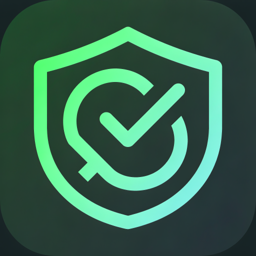
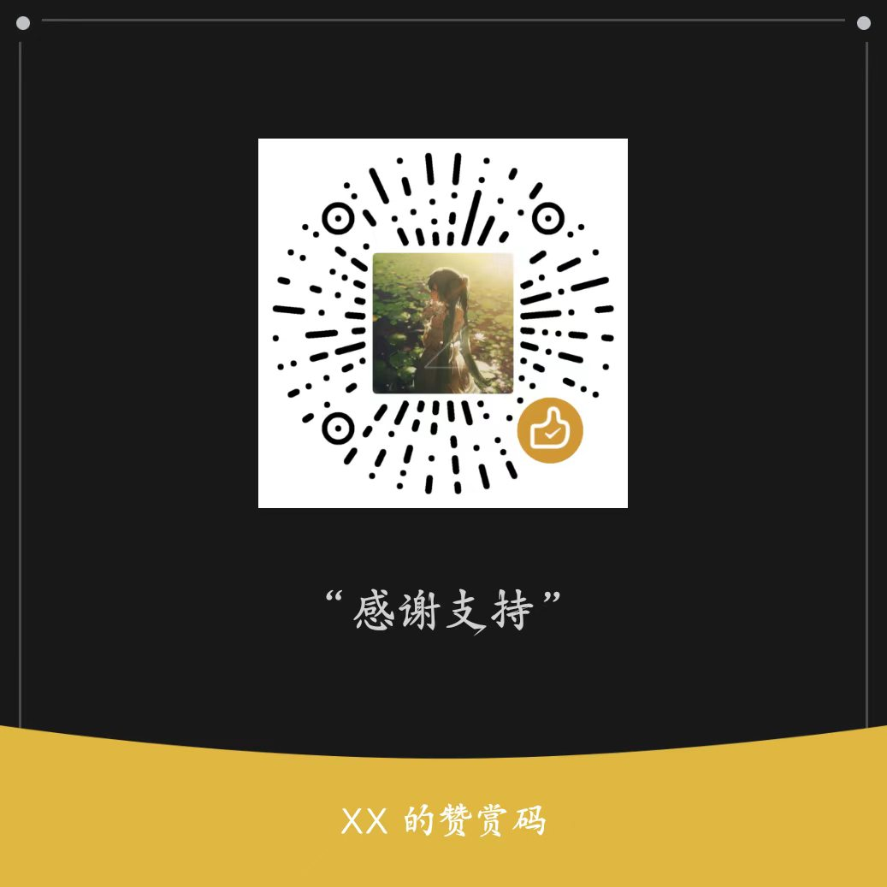

<div align="center">
  
</div>

# acmesh-panel

[](https://github.com/ForAllCodeSouls/acmesh-panel/actions/workflows/ci.yml)
[](https://github.com/ForAllCodeSouls/acmesh-panel/actions/workflows/docker.yml)
[](LICENSE)

**一个带账号密码登录的轻量 acme.sh 证书管理面板。** Go 单二进制 + 内嵌前端，跑在 Alpine 容器里，镜像约 35 MB；支持 DNS API 自动签发（含泛域名）、按域名自定义 ACME 邮箱、Webhook 通知，证书与私钥可在 Web 里查看、复制、下载。

---

## ☕ 支持本项目

如果这个面板帮你省过一次续期的麻烦，欢迎自愿赞赏一杯咖啡 ☕。
赞赏**完全自愿**：不影响任何功能、不换取任何服务承诺、不是付费墙。

| 微信支付 | 支付宝 |
| :------: | :----: |
|  |  |

---

## 目录

- [1. 功能一览](#1-功能一览)
- [2. 环境要求](#2-环境要求)
- [3. 快速开始（Docker）](#3-快速开始docker)
- [4. Docker 部署](#4-docker-部署)
- [5. 二进制部署（不用 Docker）](#5-二进制部署不用-docker)
- [6. 源码构建](#6-源码构建)
- [7. 开发与测试](#7-开发与测试)
- [8. Web 界面使用](#8-web-界面使用)
- [9. 配置参考](#9-配置参考)
- [10. 安全模型](#10-安全模型)
- [11. GitHub 自动构建与发布](#11-github-自动构建与发布)
- [12. 常见问题](#12-常见问题)
- [13. 目录结构](#13-目录结构)
- [14. 致谢与许可](#14-致谢与许可)

---

## 1. 功能一览

| 分类 | 能力 |
|---|---|
| **登录认证** | 单账号 + PBKDF2-HMAC-SHA256（600k 次迭代）；Cookie `HttpOnly` + `SameSite=Strict`；CSRF Token + Origin 校验；5 次失败按 IP 指数退避锁定；可选「保持登录」90 天 |
| **证书管理** | 扫描 acme.sh home，解析 x509：SAN、签发者、有效期、密钥类型、剩余天数、过期告警 |
| **签发** | DNS API 自动验证，支持泛域名；内置阿里云 / Cloudflare / DNSPod / 腾讯云 / GoDaddy / 华为云 / AWS / Namecheap；ECC 256/384、RSA 2048/4096 |
| **邮箱** | 全局默认 ACME 邮箱 + 按域名覆盖，留空自动回落 |
| **通知** | Gotify / 通用 Webhook / Server 酱³ / 钉钉 / 飞书 / Bark，11 种事件可订阅 |
| **私钥** | 明文查看 + 一键复制 + 下载，二次确认 + 审计 + 60 秒自动清屏 |
| **续期** | 单个 / 强制 / 全部；内置调度每 12 小时 `acme.sh --cron`，不依赖容器内 cron |
| **部署** | `--install-cert` 输出到 `/data/output/<证书>/`，路径固定 |
| **证书同步** | 挂载目录自动覆盖：签发/续期后把新证书与私钥写入匹配文件；5 种匹配模式（精确域名 / 子域 / 通配 / 文件名 / 现有证书 CN-SAN），原子替换、权限保留 |
| **吊销 / 移除** | `--revoke`、`--remove`（可选连带删除磁盘目录） |
| **审计** | 登录、失败、CSRF 拦截、签发、续期、私钥查看、部署、删除、改密全量 JSONL，Web 可查 |
| **前端** | 手写 HTML/CSS/JS，`go:embed` 进二进制，严格 CSP，无框架无 CDN |

---

## 2. 环境要求

| 场景 | 要求 |
|---|---|
| Docker 部署 | Docker 20.10+ 与 Docker Compose v2（`docker compose` 子命令） |
| 二进制部署（Linux） | 任意 glibc/musl 发行版，静态链接无依赖；另需自行安装 `acme.sh` + `curl` + `openssl` |
| 二进制部署（Windows） | Windows 10/11 x64；acme.sh 需 WSL / Git Bash，或直接用 Docker |
| 源码构建 / 测试 | Go 1.24+、Python 3.12+、Node 20+（Node 仅用于前端静态检查） |
| 端口 | **宿主机 8800** → 容器 8080（容器内不需要改） |
| 出网 | 签发时需要访问 CA 与 DNS 服务商 API；不能出网请配代理 |

---

## 3. 快速开始（Docker）

```bash
cp .env.example .env
openssl rand -base64 24        # 把输出填进 .env 的 ACME_PANEL_PASSWORD
docker compose pull
docker compose up -d
docker compose ps
```

浏览器打开 `http://服务器IP:8800`（本机可用 `http://127.0.0.1:8800`），账号 `admin`，密码是 `.env` 里设置的那个。

---

## 4. Docker 部署

### 4.1 准备 `.env`

`ACME_PANEL_PASSWORD` 必填（不填 compose 会直接报错退出）；`ACMESH_IMAGE_TAG` 默认 `latest`，可固定为 `0.1.0`。

```bash
cp .env.example .env
openssl rand -base64 24
```

### 4.2 启动：两种方式

**A. 用 GitHub 构建的镜像（推荐，本机不需要构建环境）**

```bash
docker compose pull
docker compose up -d
```

**B. 从当前源码本地构建**

```bash
docker compose -f docker-compose.yml -f docker-compose.build.yml up -d --build
```

`docker-compose.build.yml` 是 override，用当前目录的 Dockerfile 构建，镜像名 `acmesh-panel:local`；不加它时只使用 GHCR 镜像。

### 4.3 完整配置模板（Dockge / Portainer 复制即用）

**Compose（整段粘贴）**

```yaml
services:
  acmesh-panel:
    image: ghcr.io/forallcodesouls/acmesh-panel:${ACMESH_IMAGE_TAG:-latest}
    container_name: acmesh-panel
    restart: unless-stopped
    ports:
      - "0.0.0.0:8800:8080"
    environment:
      ACME_PANEL_USER: "${ACME_PANEL_USER:-admin}"
      ACME_PANEL_PASSWORD: "${ACME_PANEL_PASSWORD:?请在 .env 设置密码}"
      ACME_PANEL_COOKIE_SECURE: "${ACME_PANEL_COOKIE_SECURE:-0}"
      ACME_PANEL_TRUST_PROXY: "${ACME_PANEL_TRUST_PROXY:-0}"
      ACME_PANEL_CRON: "${ACME_PANEL_CRON:-1}"
      ACME_PANEL_SYNC_DIR: "${ACME_PANEL_SYNC_DIR:-}"
      ACME_PANEL_CA: "${ACME_PANEL_CA:-letsencrypt}"
      ACME_PANEL_EMAIL: "${ACME_PANEL_EMAIL:-}"
      TZ: "${TZ:-Asia/Shanghai}"
    volumes:
      - acme_home:/acme.sh
      - panel_data:/data
      # 证书同步（可选）：取消注释并把 .env 的 ACME_PANEL_SYNC_DIR 设为 /certs
      # - /home/web/certs:/certs
    read_only: true
    tmpfs:
      - /tmp:size=16m,mode=1777
    cap_drop:
      - ALL
    security_opt:
      - no-new-privileges:true
    healthcheck:
      test: ["CMD", "wget", "-q", "-O-", "http://127.0.0.1:8080/api/health"]
      interval: 30s
      timeout: 3s
      retries: 3
      start_period: 5s

volumes:
  acme_home:
  panel_data:
```

**.env（整段粘贴，密码换成自己的）**

```
ACMESH_IMAGE_TAG=latest
ACME_PANEL_USER=admin
ACME_PANEL_PASSWORD=换成至少12位的强密码
ACME_PANEL_COOKIE_SECURE=0
ACME_PANEL_TRUST_PROXY=0
ACME_PANEL_CRON=1
ACME_PANEL_CA=letsencrypt
ACME_PANEL_EMAIL=you@example.com
TZ=Asia/Shanghai
```

**一键命令（Windows PowerShell，自动生成密码）**

```powershell
cd D:\project\acmesh-panel\acmesh-panel
Copy-Item .env.example .env -Force
$panelPwd = 'Acme_' + [guid]::NewGuid().ToString('N').Substring(0,20)
(Get-Content .env -Raw) -replace 'ACME_PANEL_PASSWORD=.*', "ACME_PANEL_PASSWORD=$panelPwd" | Set-Content .env -Encoding ascii -NoNewline
Write-Host "登录密码: $panelPwd" -ForegroundColor Green
docker compose pull
docker compose up -d
docker compose ps
```

**一键命令（Linux / macOS）**

```bash
cd acmesh-panel
cp .env.example .env
sed -i "s|^ACME_PANEL_PASSWORD=.*|ACME_PANEL_PASSWORD=$(openssl rand -base64 24 | tr -dc 'A-Za-z0-9' | head -c 24)|" .env
docker compose pull && docker compose up -d && docker compose ps
```

**各面板怎么填**

| 面板 | 操作 |
|---|---|
| Dockge | 堆栈名称 `acmesh-panel`；Compose 框粘贴 YAML；.env 框粘贴 .env；点「部署」 |
| Portainer | Stacks → Add stack → Web editor 粘贴 YAML；.env 粘到 "Load variables from .env file" |
| 宝塔 / 1Panel | 「Compose 模板」新建，YAML 用上面内容，环境变量按 .env 逐条填 |

> **端口说明**：`0.0.0.0:8800:8080` 表示监听所有网卡的 8800 → 容器 8080。只想改对外端口，改冒号左边的数字即可。

### 4.4 日常运维命令

| 命令 | 作用 |
|---|---|
| `docker compose ps` | 查看容器状态与 health |
| `docker compose logs -f acmesh-panel` | 实时日志（首次随机密码也打印在这里） |
| `docker compose restart` | 重启容器（不重建，不会重读 .env） |
| `docker compose up -d` | 应用 `.env` / compose 变更并重建 |
| `docker compose down` | 停止并删除容器，**数据卷保留** |
| `docker compose down -v` | ⚠️ 连证书和面板数据一起删除，不可恢复 |
| `docker compose exec acmesh-panel /acme.sh/acme.sh --version` | 在容器里调用 acme.sh |
| `docker compose pull && docker compose up -d` | 升级镜像 |

### 4.5 远程访问

默认监听所有网卡的 `0.0.0.0:8800`，浏览器直接打开 `http://服务器IP:8800`。如服务器有防火墙/安全组，需放行 8800 端口。

需要域名 + HTTPS 时，可用 Caddy 或 Nginx 反代：

**Caddy**

```
certs.example.com {
    reverse_proxy 127.0.0.1:8800
}
```

**Nginx**

```nginx
server {
    listen 443 ssl http2;
    server_name certs.example.com;
    ssl_certificate     /etc/nginx/certs/fullchain.pem;
    ssl_certificate_key /etc/nginx/certs/key.pem;

    location / {
        proxy_pass http://127.0.0.1:8800;
        proxy_set_header Host $host;
        proxy_set_header X-Forwarded-For $remote_addr;   # 同时设 ACME_PANEL_TRUST_PROXY=1
        proxy_buffering off;                              # SSE 实时日志需要
        proxy_read_timeout 3600s;
    }
}
```

也可以让面板自己终结 TLS：挂载证书并设置 `ACME_PANEL_TLS_CERT` / `ACME_PANEL_TLS_KEY`，端口照样映射 8800。

### 4.6 数据卷与备份

| 卷 | 挂载点 | 内容 |
|---|---|---|
| `panel_data` | `/data` | 密码哈希、加密凭证、审计日志、任务记录（jobs.json）、部署输出 |
| `acme_home` | `/acme.sh` | acme.sh 脚本、账户密钥、证书 |

`docker compose down` 不会删卷。备份：

```bash
# 先用 docker volume ls 确认实际卷名（通常是 <目录名>_panel_data）
docker run --rm -v $(basename $(pwd))_panel_data:/data -v "$PWD:/backup" alpine \
  tar czf /backup/panel-data.tgz -C /data .
```

恢复时保持 `state.json` 与 `secret.key` 成对，否则已保存凭证需重新录入。
`acme.sh` 会把 DNS API 凭证写入 `/acme.sh/account.conf`（明文，续期要用），该卷也要按敏感数据保护。

### 4.7 升级

```bash
docker compose pull
docker compose up -d
docker compose ps
```

固定版本：把 `.env` 的 `ACMESH_IMAGE_TAG` 改成具体 tag（如 `0.1.0`）。升级不会动数据卷。

### 4.8 直接 run（不用 compose）

```bash
docker run -d --name acmesh-panel \
  -p 0.0.0.0:8800:8080 \
  -e ACME_PANEL_PASSWORD='一个足够长的随机密码' \
  -e ACME_PANEL_EMAIL='you@example.com' \
  -v acme_home:/acme.sh -v panel_data:/data \
  --read-only --tmpfs /tmp:size=16m \
  --cap-drop ALL --security-opt no-new-privileges:true \
  ghcr.io/forallcodesouls/acmesh-panel:latest
```

---

## 5. 二进制部署（不用 Docker）

**注意**：二进制只包含面板本身，`acme.sh` 需要另外安装（Docker 镜像里已内置）。

### 5.1 前置：安装 acme.sh

```bash
curl https://get.acme.sh | sh -s email=you@example.com
# 安装位置通常是 ~/.acme.sh
```

### 5.2 Linux（amd64 / arm64）

**方式 A：一键安装（从 Release 下载对应架构）**

```bash
curl -fsSL https://raw.githubusercontent.com/ForAllCodeSouls/acmesh-panel/main/install.sh | sh
```

**方式 B：手动下载**

1. 打开 [Releases](https://github.com/ForAllCodeSouls/acmesh-panel/releases)，下载 `acmesh-panel-linux-amd64` 或 `acmesh-panel-linux-arm64`
2. 校验（可选）：`sha256sum -c SHA256SUMS`
3. 运行：

```bash
chmod +x acmesh-panel-linux-amd64

ACME_HOME="$HOME/.acme.sh" \
ACME_BIN="$HOME/.acme.sh/acme.sh" \
ACME_PANEL_DATA="$HOME/.acmesh-panel" \
ACME_PANEL_LISTEN=0.0.0.0:8800 \
ACME_PANEL_PASSWORD='一个足够长的随机密码' \
./acmesh-panel-linux-amd64
```

打开 `http://服务器IP:8800`。

**做成 systemd 服务（可选）**

```ini
# /etc/systemd/system/acmesh-panel.service
[Unit]
Description=acmesh-panel
After=network-online.target

[Service]
User=acme
Environment=ACME_HOME=/home/acme/.acme.sh
Environment=ACME_BIN=/home/acme/.acme.sh/acme.sh
Environment=ACME_PANEL_DATA=/home/acme/.acmesh-panel
Environment=ACME_PANEL_LISTEN=0.0.0.0:8800
EnvironmentFile=/etc/acmesh-panel.env
ExecStart=/usr/local/bin/acmesh-panel
Restart=on-failure
NoNewPrivileges=true

[Install]
WantedBy=multi-user.target
```

```bash
sudo systemctl daemon-reload && sudo systemctl enable --now acmesh-panel
```

### 5.3 Windows（x64）

1. 从 Release 下载 `acmesh-panel-windows-amd64.exe`
2. PowerShell 里运行：

```powershell
.\acmesh-panel-windows-amd64.exe version

$env:ACME_PANEL_LISTEN="0.0.0.0:8800"
$env:ACME_PANEL_PASSWORD="换成你的强密码"
$env:ACME_PANEL_DATA="$HOME\.acmesh-panel"
$env:ACME_HOME="$HOME\.acme.sh"
$env:ACME_BIN="$HOME\.acme.sh\acme.sh"
.\acmesh-panel-windows-amd64.exe
```

Windows 上 acme.sh 需要 WSL / Git Bash 环境；只想用面板的话建议直接跑 Docker。

### 5.4 二进制版和 Docker 版的区别

| | Docker | 二进制 |
|---|---|---|
| acme.sh | 已内置，随镜像更新 | 需自行安装维护 |
| 依赖 | 无（镜像自带 curl/openssl/bash） | 需 curl、openssl、bash |
| 升级 | `docker compose pull` | 重新下载二进制 |
| 数据位置 | 命名卷 `/data`、`/acme.sh` | 由 `ACME_PANEL_DATA`、`ACME_HOME` 决定 |
| 适合 | 生产、群晖/威联通、宝塔 | 不想装 Docker 的轻量场景 |

---

## 6. 源码构建

```bash
make build          # 本地二进制 bin/acmesh-panel
make image          # 单架构镜像
make image-multi    # amd64 + arm64（buildx，需 --push 或单独 --load）
```

Dockerfile 只需要 `go.mod` + `*.go` + `web/`，构建阶段**零网络依赖**（无 `go mod download`）。
acme.sh 从 GitHub 拉取 tag `v3.1.1`，失败自动回退 `master`；内网构建可改成 `ADD acme.sh.tar.gz`。

---

## 7. 开发与测试

- 零第三方 Go 依赖：只用标准库，`go build` 不需要联网
- 前端不用构建工具，直接改 `web/index.html` / `web/style.css` / `web/app.js`；严格 CSP 禁止内联脚本与内联 style

```bash
make run         # 用 tests/fake-acme.sh 在 0.0.0.0:8800 起开发实例
make test        # go vet + 端到端（79 项断言）
make ui-test     # 前端选择器 / DOM id 一致性检查
gofmt -w *.go && go vet ./...
```

端到端测试会真实启动面板进程 + 假 acme.sh + 本地 Webhook 接收器，覆盖认证、CSRF、限流、签发、私钥审计、路径穿越、通知推送等。
提交前请全部跑一遍，详见 [CONTRIBUTING.md](CONTRIBUTING.md)。

---

## 8. Web 界面使用

### 8.1 邮箱：全局默认 + 按域名覆盖

- 「通知 → 默认 ACME 通知邮箱」设置全局邮箱，签发时传给 `--accountemail`
- 签发时填「ACME 通知邮箱」即该域名专用；**留空自动使用默认邮箱**
- 证书详情「修改邮箱」可改，清空即恢复默认
- 换邮箱等于换 ACME 账户，需重新签发才生效；续期沿用原账户

### 8.2 Webhook 通知

| 类型 | 需要填 |
|---|---|
| Gotify | 服务地址（如 `https://push.example.com`）+ 应用 Token |
| 通用 Webhook | 完整 URL + 可选 Bearer Token，POST JSON：`{title, message, event, time, level}` |
| Server 酱³ | SendKey |
| 钉钉 | 群机器人 Webhook + 可选加签 Secret |
| 飞书 | 群机器人 Webhook + 可选签名密钥 |
| Bark | Bark Key |

事件：`cert_issued` / `issue_failed` / `cert_renewed` / `renew_failed` / `cert_expiring`（≤30 天，每天一次）/ `cert_revoked` / `cert_removed` / `cert_deployed` / `security_alert`。

渠道 URL 与 Token **整体加密存储**，接口只回掩码；通知正文不含私钥、证书或 DNS 凭证。

### 8.3 签发 / 查看 / 部署

**签发**：填域名（每行一个，首个为主域名）→ 选 DNS 服务商与凭证（可加密保存）→ 选密钥类型与 CA → 提交后跳到任务页看 SSE 实时日志。

| 服务商 | 字段 |
|---|---|
| 阿里云 | `Ali_Key` / `Ali_Secret` |
| Cloudflare | `CF_Token` |
| DNSPod.cn | `DP_Id` / `DP_Key` |
| 腾讯云 | `Tencent_SecretId` / `Tencent_SecretKey` |
| GoDaddy | `GD_Key` / `GD_Secret` |
| 华为云 | `HUAWEICLOUD_Username` / `Password` |
| AWS | `AWS_ACCESS_KEY_ID` / `AWS_SECRET_ACCESS_KEY` |
| Namecheap | `NAMECHEAP_USERNAME` / `API_KEY` |

泛域名 `*.example.com` 必须走 DNS API 验证。想先测试可选 CA 的「Let's Encrypt (测试环境)」。

**私钥**：证书卡片「私钥」→ 勾选风险确认 → 明文显示 → 复制或下载 `.key`；每次写审计，前端 60 秒自动清屏。

**部署**：详情抽屉「部署到 /data/output」，输出 `key.pem` / `fullchain.pem` / `cert.pem` / `chain.pem`。

**续期**：内置调度每 12 小时 `acme.sh --cron`（签发后 3 分钟先跑一次）；也可手动「检查全部续期」或单证书强制续期。未到续期时间时 acme.sh 会跳过：面板将其标记为「未到期」而非失败，手动续期会提示距过期与下次可续签时间，自动调度保持静默且不推送通知；确实要提前续签可在单证书续期时勾选「强制续签」。

**证书同步**：左侧「证书同步」页。先设置环境变量 `ACME_PANEL_SYNC_DIR` 指向挂载进来的目录（如 `/certs`），重启后在页面里新建规则：

| 匹配模式 | 说明 | 典型场景 |
|---|---|---|
| 精确域名 | 目标文件名域名与证书主域名一致 | `example.com_cert.pem` ↔ `example.com` |
| 子域名（含通配） | 目标是证书域名的子域 | `sub.example.com_cert.pem` ↔ `*.example.com` |
| 仅通配符 SAN | 只按证书里 `*.` 开头的 SAN 匹配 | 严格限定泛域名证书 |
| 文件名模式 | glob 匹配文件名 | `*_cert.pem`、`site-*.pem` |
| 现有证书 CN/SAN | 读取目录里已有证书，按 CN/SAN 交集匹配 | 目录里证书与面板证书同一套 |

匹配到目录里的文件后，**按文件名自动判断该写什么**：名字含 `key` / `priv` 的写入新私钥（权限 0600），含 `chain` / `ca` 的写入新证书链，其余（含 `cert` / `fullchain`）写入新证书（权限 0644）。例如目录里的 `sub.example.com_cert.pem` 写入证书、`sub.example.com_key.pem` 写入私钥，逐个独立覆盖，不需要额外配置模板。

页面顶部会列出挂载目录里现有的文件（文件名、识别出的域名、类型、大小），方便确认目标。新建或编辑规则时可点「预览匹配」，先看看会覆盖哪些文件、每个文件写入什么内容——预览只计算不写入，确认无误再保存。签发或续期成功后自动触发，也可点「立即同步」手动执行。写入采用先写临时文件再 rename 的方式，不会写坏目标文件；每次都记入审计与同步记录，并可订阅 `cert_synced` / `sync_failed` 推送。

> Docker 挂载示例：`-v /home/web/certs:/certs -e ACME_PANEL_SYNC_DIR=/certs`，目录里的 `sub.example.com_cert.pem` / `_key.pem` 会在续期后被自动覆盖。多个目录用逗号或分号分隔：`ACME_PANEL_SYNC_DIR=/certs,/srv/ssl`，并分别挂载卷。

> **挂载目录权限**：面板以 uid 10001 运行。若同步报 `permission denied`，说明挂载目录属主不对。在服务器执行下面这条**一键修复**（把路径换成你实际挂载的目录），不用逐个改：
> ```bash
> docker run --rm -v /home/web/certs:/fix alpine:3.21 chown -R 10001:10001 /fix
> ```
> 注意 `chown -R 属主:组 目录`，属主写在前面。也可以直接在宿主机执行 `chown -R 10001:10001 /home/web/certs`。「证书同步」页会显示每个目录是否可读写。

---

## 9. 配置参考

| 变量 | 默认 | 说明 |
|---|---|---|
| `ACME_PANEL_PASSWORD` | 随机生成 | 12 位以上；启动时与已存哈希比对，不一致则重置（可找回密码） |
| `ACME_PANEL_USER` | `admin` | 登录账号（仅首次初始化写入） |
| `ACME_PANEL_LISTEN` | `0.0.0.0:8080` | **容器内**监听地址，映射到宿主 8800，一般不用改 |
| `ACME_PANEL_DATA` | `/data` | 状态、密钥、审计、部署输出 |
| `ACME_HOME` | `/acme.sh` | acme.sh home |
| `ACME_PANEL_CA` | `letsencrypt` | `letsencrypt` / `zerossl` / `buypass` / `google` / `letsencrypt_test` |
| `ACME_PANEL_EMAIL` | 空 | 签发时传给 `--accountemail`；设置后会覆盖 Web 里保存的默认邮箱 |
| `ACME_PANEL_COOKIE_SECURE` | `0` | 走 HTTPS 后设 `1`，Cookie 加 `Secure` 并下发 HSTS |
| `ACME_PANEL_TRUST_PROXY` | `0` | 信任 `X-Forwarded-For`（仅反代可信时开启） |
| `ACME_PANEL_CRON` | `1` | 内置续期调度开关（关闭后仍每 12 小时检查临期提醒） |
| `ACME_PANEL_PARALLEL` | `2` | 同时运行的 acme.sh 任务数 |
| `ACME_PANEL_SYNC_DIR` | 空（禁用） | 证书同步目录，多个用逗号/分号分隔，如 `/certs,/srv/ssl`；签发/续期后自动覆盖匹配文件 |
| `ACME_PANEL_TLS_CERT` / `_KEY` | 空 | 面板自己做 TLS 终结，自动开启 Cookie Secure |
| `ACMESH_IMAGE_TAG` | `latest` | compose 使用的 GHCR 镜像标签 |

---

## 10. 安全模型

| 威胁 | 处理方式 |
|---|---|
| 未授权访问 | 全局 `requireAuth`；除 `/api/login`、`/api/health`、静态资源外一律 401 |
| 会话劫持 | 登录即新建会话（防固定）、`HttpOnly` + `SameSite=Strict`、30 分钟空闲 / 12 小时绝对过期、改密后其它会话失效 |
| CSRF | SameSite Cookie + 每会话随机 Token + `Origin/Referer` 比对 |
| 暴力破解 | 5 次失败起阶梯锁定 5/10/20/40/60 分钟；恒定时间比较 |
| 命令注入 | `exec.CommandContext` + argv，无 `sh -c`；子命令 / CA / 密钥类型 / 域名 / 证书名全部白名单校验 |
| 环境变量注入 | 凭证字段必须命中服务商目录，`PATH` / `LD_PRELOAD` 直接 400 |
| 路径穿越 | 正则 + `filepath.Clean` 前缀校验；部署路径固定 `/data/output/<name>` |
| 凭证泄露 | AES-256-GCM 落盘；API 只回掩码；日志按值脱敏 |
| 私钥泄露 | 登录 + CSRF + 显式确认 + 审计 + `no-store`；前端 60 秒清除 |
| Webhook 滥用 | URL + Token 整体加密；只接受 http(s)；通知不含私钥/凭证 |
| XSS / 点击劫持 | 严格 CSP、统一转义、`X-Frame-Options: DENY` |
| 容器逃逸 | 非 root uid 10001、只读根、`cap_drop: ALL`、`no-new-privileges` |

**已知边界**：单账号（无 RBAC）；私钥按设计允许管理员查看；acme.sh 会把 DNS 凭证明文写进 `/acme.sh/account.conf`；面板默认不终结 TLS。详见 [SECURITY.md](SECURITY.md)。

---

## 11. GitHub 自动构建与发布

### 11.1 镜像（GHCR）

push 到 `main` 或打 `v*` 标签，`.github/workflows/docker.yml` 自动构建并发布到 GHCR，使用内置 `GITHUB_TOKEN`，无需额外密钥：

```bash
docker pull ghcr.io/forallcodesouls/acmesh-panel:latest
```

- `main` → `latest` / `main`
- tag `v0.1.0` → `0.1.0` / `sha`

GHCR 镜像名必须小写，workflow 已把 `ForAllCodeSouls` 转成 `forallcodesouls`。
首次使用请到 **Settings → Actions → General → Workflow permissions** 选 **Read and write**。

### 11.2 二进制（Releases）

**push 到 `main` 即自动触发**：`.github/workflows/release.yml` 读取 `version.go` 里的版本号，编译三平台二进制、生成 `SHA256SUMS`，并创建/更新同名 Release，无需手动操作。

也可以手动指定版本号：Actions → 左侧 **Release** → **Run workflow**，填版本号覆盖（留空则读 version.go）；或打标签：

```bash
git tag v0.1.0 && git push origin v0.1.0
```

产物：`linux-amd64`、`linux-arm64`、`windows-amd64.exe`、`SHA256SUMS`，
Release 正文自带 Docker / Linux / Windows 三种用法的说明。同名 Release 已存在时会自动更新其中的资源，不会失败。

---

## 12. 常见问题

| 现象 | 处理 |
|---|---|
| `docker compose up` 报 `ACME_PANEL_PASSWORD is required` | 没建 `.env` 或没填密码 |
| 容器反复重启 / `exit code 1` | `docker compose logs acmesh-panel` 看原因；若报 `cp: can't stat '/opt/acme-template/': Permission denied`，是旧镜像模板目录权限问题，升级到 0.1.0+ 已修复 |
| 容器反复重启（其它权限问题） | `docker compose logs acmesh-panel` 看原因；若是权限问题按下方「挂载目录权限」修复 |
| 同步报 `permission denied` | 挂载目录属主不是 10001。执行一键修复：`docker run --rm -v /home/web/certs:/fix alpine:3.21 chown -R 10001:10001 /fix`（换成你的目录）。属主写在前面，别写成 `chown -R 目录 10001:10001` |
| 同步只匹配了证书、没匹配私钥 | 确认已升级到 0.0.7+；新版本按文件名判断：含 `key` 写新私钥、含 `cert` 写新证书，预览里会分别列出。文件名模式若填了 `*_cert.pem` 只会匹配证书文件，想同时匹配私钥请改成 `*example.com*` 或 `*.pem` |
| 续期提示「未到续期时间」 | 正常：acme.sh 默认到期前 30 天才续期。想提前续期用单证书续期的「强制续签」 |
| 通知渠道里看不到「证书同步成功/失败」 | 关闭通知页再重新打开（每次打开都会重新拉取事件目录） |
| 重启后任务记录消失 | 0.0.6+ 已落盘到 `/data/jobs.json`，确认没有删除 `panel_data` 卷 |
| 忘记密码 | 改 `.env` 的 `ACME_PANEL_PASSWORD` 后 `docker compose up -d`，启动时按新值重置 |
| 改了 `.env` 没生效 | 要 `docker compose up -d` 重建；`restart` 不重读环境变量 |
| 拉 GHCR 镜像 401/denied | 私有仓库先 `docker login ghcr.io -u ForAllCodeSouls`（Token 需 `read:packages`） |
| 8800 端口打不开 | 检查服务器防火墙 / 安全组是否放行 8800；docker compose ps 看端口映射是否为 `0.0.0.0:8800->8080/tcp` |
| 端口被占用 | 改 `ports` 左侧端口，如 `"0.0.0.0:8801:8080"` |
| 签发失败 | 看任务页日志：DNS 凭证权限、NS 未指向服务商、CA 频率限制（先换 Staging） |
| 改了邮箱但续期没换 | 换邮箱等于换账户，需强制重新签发 |
| 二进制启动后提示未找到 acme.sh | 设 `ACME_HOME` / `ACME_BIN`，或先 `curl https://get.acme.sh \| sh` |
| 刷新页面回到证书首页 | 0.0.7+ 会记住上次所在页面；若仍回到首页，检查浏览器是否禁用了 localStorage |

---

## 13. 目录结构

```
.
├── main.go            入口、配置、路由、安全响应头、内置续期调度
├── api.go             HTTP handlers（认证 / 证书 / 签发 / 凭证 / 通知 / 任务 / 审计）
├── auth.go            会话、CSRF、登录限流、来源校验
├── store.go           状态持久化、PBKDF2、AES-256-GCM、审计日志
├── acme.go            服务商目录、参数校验、acme.sh 调用、任务队列与日志脱敏
├── certs.go           证书扫描与 x509 解析、私钥读取、目录清理
├── notify.go          通知渠道、多渠道发送、事件映射、临期检查
├── sync.go            证书同步：挂载目录匹配、原子覆盖、规则与记录
├── version.go         版本号（ldflags 注入）
├── web/               index.html / style.css / app.js / assets（go:embed）
├── tests/             fake-acme.sh、e2e.py、ui-check.js
├── assets/            原创 logo 与赞赏码图片
├── Dockerfile         多阶段构建，非 root uid 10001 运行
├── docker-compose.yml 默认使用 GHCR 镜像（宿主 8800）
├── docker-compose.build.yml  本地源码构建 override
├── install.sh         一键安装预编译二进制
└── Makefile
```

---

## 14. 致谢与许可

**致谢**

- [acme.sh](https://github.com/acmesh-official/acme.sh) —— 真正完成 ACME 协议、DNS API 验证与续期逻辑的是它

**许可**

MIT © 2026 ForAllCodeSouls

本项目自己的代码按 MIT 发布；`acme.sh` 及其依赖遵循各自的许可（acme.sh 本身为 MIT）。
